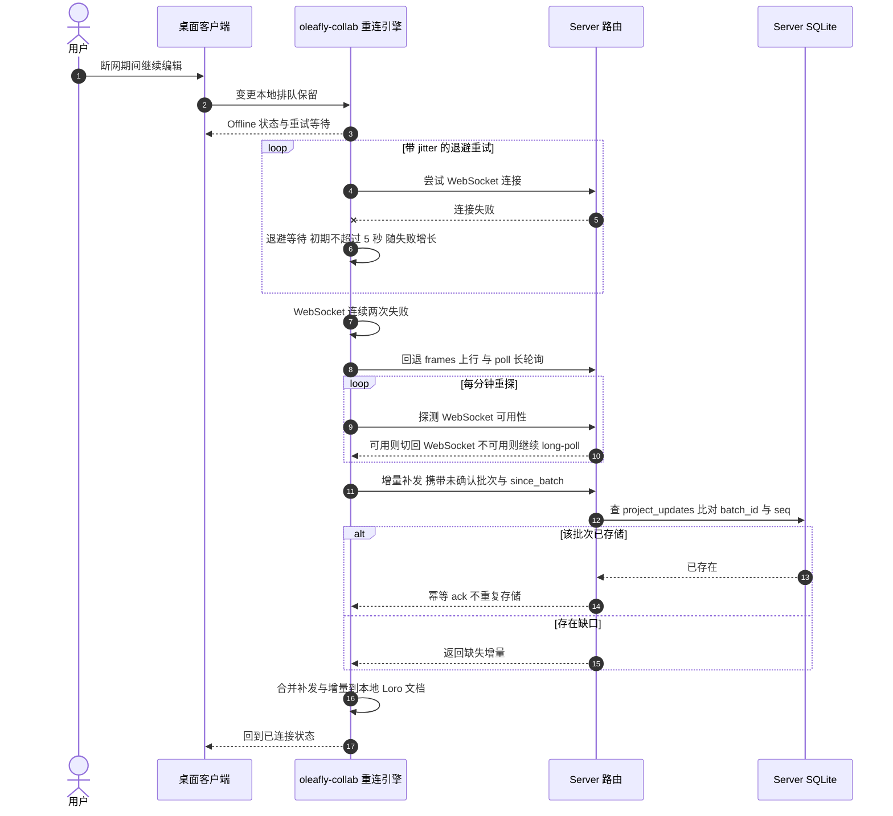

## ADDED — S31 断线重连与增量补发 场景实现（现状基线）

> module: collab | 场景编号: S31（全局唯一，见 `core-00-scenario-overview.md` 编号注册表） | 优先级: P0
> 基线口径：桌面 0.4.11，绑定提交 `9c307bf3c`（HEAD，领先 `v0.4.11` 标签 3 个提交）
> 本文档为存量产品现状基线：只描述已实现行为，事实来源为提案 `logos/changes/add-baseline-docs/inventory.md` collab 段（S31 行与该段引言）与 `deltas/prd/1-product-requirements/collab-01-requirements.md` §四 S31 章节。**本次为只读静态盘点，未执行任何测试**，动态行为在 verify 阶段单独取证。
> 本文档不新增功能、不修复文档偏差，基线一律以实现为准。

### 一、触发与前置

- **触发条件**：网络中断、Server 暂时不可用或客户端重启（需求文档 S31 触发条件）。
- **前置条件**：
  - 客户端已建立实时通道，且传输选项采用默认策略：`fallback_after = 2`、`retry_socket_every = 60s`、`ping_every = 20s`、`quiet_for = 30s`；
  - 会话协议版本已按 **collab protocol v1 的 min/max 协商**确定；重连沿用同一协商结果，**不兼容即停止同步**；
  - 客户端本地保留断网期间产生的未同步变更（S30 的批处理队列）；
  - Server 侧以 `batch_id` + `seq` 记录已确认批次，用于补发定位与幂等判定；
  - 本场景的回退（`/frames` + `/poll` long-poll）**只存在于桌面端**；浏览器端只有 WS 重连（见 S40）。

### 二、参与者

| 参与者 | 形态 | 职责 | 证据 |
|---|---|---|---|
| 桌面客户端 | Tauri 桌面应用 | 展示离线状态与重试等待；断网期间继续编辑并保留本地变更；恢复后触发补发 | `crates/oleafly-collab/src/sync/mod.rs`；`src/features/collab/sharing/sync-display.tsx` |
| oleafly-collab | Rust crate（重连引擎） | 退避与 jitter 计算、WebSocket↔long-poll 通道切换、补发（catch-up）请求与幂等处理 | `crates/oleafly-collab/src/sync/reconnect.rs` L49-309；`crates/oleafly-collab/src/sync/wire.rs` L3-54、L170-256 |
| Server 路由 | Rust crate `oleafly-server`（`/ws`、`/api/v1/projects/{project}/frames`、`/api/v1/projects/{project}/poll`） | 接受补发批次、按 `since_batch` 定位缺口、幂等返回 `ack` | `crates/oleafly-server/src/routes/poll.rs` L37-38；`crates/oleafly-server/src/routes/ws.rs` |
| SQLite | Server 数据库（migration 0001-0018） | `project_updates` 保存 `batch_id`/`seq`，用于判定某批是否已存储（幂等） | `crates/oleafly-server/migrations/0002_projects.sql`；`crates/oleafly-server/src/routes/ws.rs` |
| 浏览器端 | 浏览器应用 `web/` | **本场景不参与桌面回退路径**：浏览器端 WS 断线只做 WS 重连，**无 long-poll 回退**，且无离线编辑能力 | `inventory.md` collab 段 S40 行；`web/src/gateway.ts` L73-98、L280-649 |

### 三、主时序

1. **桌面客户端 / oleafly-collab** — 通道异常（网络中断、Server 不可用）被检测到，客户端进入 `Offline` 状态并显示重试等待。
2. **桌面客户端** — 断网期间用户继续编辑；变更在本地排队保留，不丢弃。
3. **oleafly-collab** — 重连尝试按**带 jitter 的退避**等待：前若干次尝试的等待上限不超过 5 秒，随失败次数增长到分钟级；一次稳定连接后计数归零重新开始。
4. **oleafly-collab** — 若 WebSocket 连接**连续两次失败**（`fallback_after = 2`），客户端**回退**到 `/frames`（POST 上行）+ `/poll`（GET 长轮询下行）的 long-poll 传输。
5. **oleafly-collab** — 处于 long-poll 通道时，客户端**每分钟**（`retry_socket_every = 60s`）重探一次 WebSocket 可用性；探测失败则继续 long-poll，探测成功则切回 WebSocket。
6. **oleafly-collab → Server 路由** — 通道恢复后发起**增量补发**：客户端携带本地未确认的批次（可含 `since_batch` 定位缺口）请求 Server。
7. **Server 路由 / SQLite** — Server 按 `batch_id`/`seq` 比对 `project_updates`：已存储的批次**幂等处理，不重复存储**，缺失部分返回。
8. **oleafly-collab** — 客户端把补发结果与 Server 返回的增量合并进本地 Loro 文档，收敛到与 Server 一致。
9. **桌面客户端** — 同步状态回到已连接；断网期间的工作完整保留，无丢失。

### 四、失败与降级分支

逐条对应需求文档 `collab-01-requirements.md` §四 S31 验收条件中的「异常」与「边界」：

| 分支 | 触发条件 | 行为（基线口径） | 证据 |
|---|---|---|---|
| WS 连续两次失败 | 桌面端 WebSocket 连续失败达到 `fallback_after = 2` | **回退 `/frames` + `/poll` long-poll**，并**每分钟重探 WS 可用性**；该回退**仅桌面端有**，浏览器端无（见 S40） | `inventory.md` collab 段 S31 行；`crates/oleafly-collab/src/sync/reconnect.rs` L168-300；`crates/oleafly-collab/src/sync/mod.rs` L191-207 |
| Server busy / 限流 | 重连请求收到 429 / 503 busy | 进入**长等待**而非高频冲击；busy 与普通失败使用不同的等待策略 | `inventory.md` collab 段 S31 行；`crates/oleafly-collab/src/sync/reconnect.rs`（`busy` / `busy_wait`） |
| 退避抖动 | 连续重试 | 退避**含 jitter**，避免多客户端同频重连；等待随失败次数增长到分钟级，稳定连接后归零重来 | `inventory.md` collab 段 S31 行；`crates/oleafly-collab/src/sync/reconnect.rs` L49-309 |
| 重启后重发已确认批次 | 客户端重启后重发已被 `ack` 的批次 | 服务端**幂等处理，不重复存储**（按 `batch_id`/`seq` 判定） | `inventory.md` collab 段 S31 行；`crates/oleafly-server/src/routes/ws.rs`；`crates/oleafly-collab/src/sync/tests/editing.rs` L130-275 |
| 通道损坏 | 项目文档被判定损坏（damaged） | 同步**结束**并给出失败结束原因，不继续在损坏状态上同步 | `crates/oleafly-collab/src/sync/reconnect.rs`；`crates/oleafly-collab/src/sync/mod.rs` L180 |
| 越权变更混入补发 | 补发批次中含超出角色的 change | **服务端逐 change 校验并拒绝**——客户端 UI 不是安全边界（详见 S33） | `inventory.md` collab 段 S33 行；`crates/oleafly-server/src/routes/ws.rs` L1057-1071 |
| 协议不兼容 | 重连时协议区间无交集 | **停止同步并明确报告**（协议 v1 的 min/max 协商无交集，见 S29），不回退到更旧协议 | `inventory.md` collab 段 S29/S31 行 |
| 浏览器端断线 | 浏览器端 WS 断线 | 只有 WS 重连，**无 long-poll 回退**；浏览器端也没有离线编辑能力（S40） | `inventory.md` collab 段 S40 行；`web/src/gateway.ts` L73-98 |

### 五、边界与证据

- **回退边界**：long-poll 回退是**桌面端专属能力**；不得把该能力表述为浏览器端也有。
- **幂等边界**：幂等由 Server 依据 `batch_id`/`seq` 与 `project_updates` 判定，客户端不做「保证不重发」的假设。
- **退避边界**：退避含 jitter，busy（429/503）走长等待；用户手动「立即重连」可提前打断长等待。
- **保密性边界**：补发内容经 Server 中转，Server 侧**不是端到端加密**（capability `encryption=None`），宿主/磁盘/备份运营者可读。
- **本场景不做**：离线冲突合并与人工审查（S32）、角色权限边界（S33）、浏览器端会话安全（S41）。
- **实现证据**（引自 `inventory.md` collab 段 S31 行）：
  - `sync/mod.rs` L191-207（传输选项：`fallback_after=2`、`retry_socket_every=60s`）；
  - `reconnect.rs` L49-309（退避、jitter、busy 长等待、WS↔poll 切换）；
  - `transport.rs` L3-54、L170-256（WebSocket 与 long-poll 两种 wire 的切换与收发）；
  - `editing.rs` L130-275（断线补发与幂等）。
- **动态验证声明**：本基线为静态盘点，上述行为**未在本次执行任何测试**；相关 Rust 集成测试需在 verify 阶段取证，不得预填 PASS。
