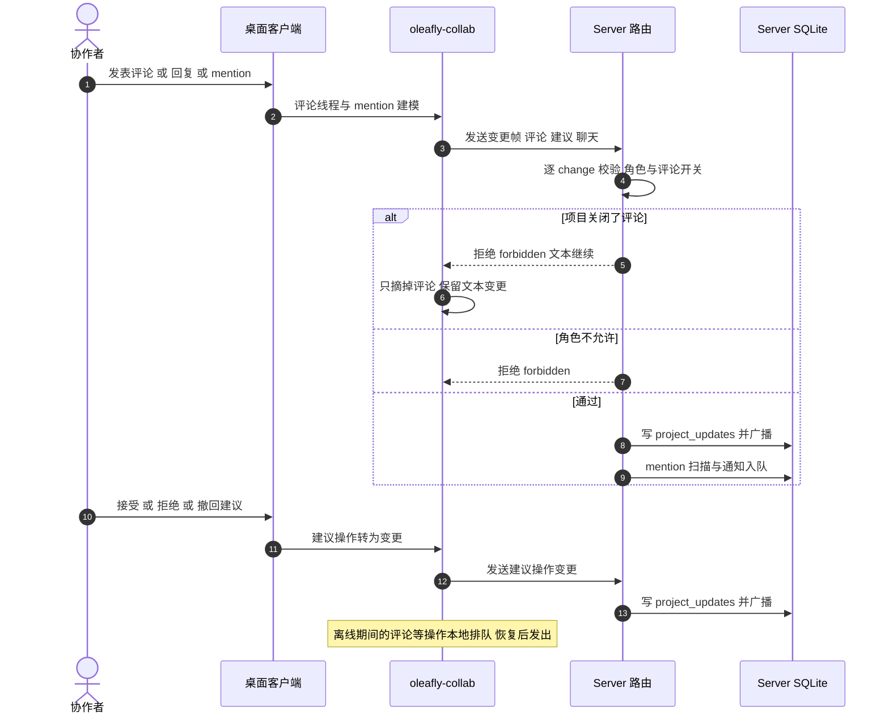

## ADDED — S34 评论建议与项目聊天 场景实现（现状基线）

> module: collab | 场景编号: S34（全局唯一，见 `core-00-scenario-overview.md` 编号注册表） | 优先级: P0
> 基线口径：桌面 0.4.11，绑定提交 `9c307bf3c`（HEAD，领先 `v0.4.11` 标签 3 个提交）
> 本文档为存量产品现状基线：只描述已实现行为，事实来源为提案 `logos/changes/add-baseline-docs/inventory.md` collab 段（S34 行与该段引言）与 `deltas/prd/1-product-requirements/collab-01-requirements.md` §四 S34 章节。**本次为只读静态盘点，未执行任何测试**，动态行为在 verify 阶段单独取证。
> 本文档不新增功能、不修复文档偏差，基线一律以实现为准。

### 一、触发与前置

- **触发条件**：协作者需要审阅、讨论与沟通（需求文档 S34 触发条件）。
- **前置条件**：
  - 项目已共享，成员持有五角色之一（角色边界见 S33）；
  - 项目级评论开关 `comments_enabled` 为开启状态（否则进入 comments off 分支）；
  - 建议能力依赖 `suggestions` 功能开关；聊天依赖 `chat` 功能开关（Server 能力清单公布）；
  - 评论/建议/聊天都是**项目内容的一部分**，随 change log 一起同步与留痕；
  - 项目内容在 Server 侧**不是端到端加密**（capability 明确 `encryption=None`）。

### 二、参与者

| 参与者 | 形态 | 职责 | 证据 |
|---|---|---|---|
| 桌面客户端 | Tauri 桌面应用 | 评论/回复/mention/resolve 界面、建议卡片与接受/拒绝/撤回、项目聊天面板 | `src/features/collab/comments/CommentsPane.tsx`、`CommentComposer.tsx`；`src/features/collab/suggestions/SuggestionCard.tsx`、`FileSuggestionActions.tsx`；`src/features/collab/chat/ChatPane.tsx` |
| oleafly-collab | Rust crate（文档与建议模型） | 建模评论线程/锚点/mention、建议的接受/拒绝/撤回、聊天消息；离线操作排队 | `crates/oleafly-collab/src/comments.rs`；`crates/oleafly-collab/src/suggestions.rs`；`crates/oleafly-collab/src/chat.rs` |
| Server 路由 | Rust crate `oleafly-server` | 逐 change 校验角色与评论开关、裁决 mention 通知、广播变更 | `crates/oleafly-server/src/role_guard.rs`；`crates/oleafly-server/src/comment_guard.rs`；`crates/oleafly-server/src/mentions.rs` |
| SQLite | Server 数据库（migration 0001-0018） | 评论/建议/聊天随 change log 落入 `project_updates`；mention 扫描与邮件入 `mention_scans` / `mention_emails` | `crates/oleafly-server/migrations/0002_projects.sql`、`0011_mention_emails.sql` |
| 浏览器端 | 浏览器应用 `web/` | 按角色映射评论/聊天能力（`abilitiesFor`），**仅是 UI 呈现，裁决仍在服务端** | `web/src/roles.ts` L14-38；`inventory.md` collab 段 S40 行 |

### 三、主时序

1. **桌面客户端** — 协作者在正文上选区发表评论，或在评论线程中回复；@mention 指定成员。
2. **oleafly-collab** — 评论建模为线程（锚点 + 正文 + mention），作为变更进入 change log。
3. **oleafly-collab → Server 路由** — 评论/建议/聊天以变更帧发送。
4. **Server 路由** — 逐 change 校验：角色是否允许该操作、项目评论开关是否开启。
5. **Server 路由 / SQLite** — 通过的变更写入 `project_updates` 并广播；mention 被扫描并进入通知队列（S38）。
6. **桌面客户端** — 其他协作者端收到变更后刷新评论线程、建议卡片与聊天面板；Reviewer 的建议以建议形式呈现。
7. **桌面客户端** — 建议可被**接受 / 拒绝 / 撤回**；接受建议才把建议内容写入正文。
8. **桌面客户端 / oleafly-collab** — 离线期间产生的评论等操作**在本地排队**，连接恢复后按序发出（与 S31 的补发共用通道）。
9. **桌面客户端** — 评论可被 resolve（标记为已解决）。

### 四、失败与降级分支

逐条对应需求文档 `collab-01-requirements.md` §四 S34 验收条件中的「异常」与「边界」：

| 分支 | 触发条件 | 行为（基线口径） | 证据 |
|---|---|---|---|
| comments off | 项目关闭了评论功能 | **新评论与对既有评论的 resolve 均被拒绝**（`Forbidden` + comments off），但**文本编辑继续不受影响**（typing 仍获 ack） | `inventory.md` collab 段 S34 行；`crates/oleafly-server/tests/comment_switch.rs` L171-366 |
| Reviewer 接受建议 | Reviewer 尝试接受建议（**含自己提出的**） | **拒绝**——Reviewer 只提出建议，不裁决建议 | `inventory.md` collab 段 S34 行；`crates/oleafly-collab/src/suggestions.rs`；`crates/oleafly-server/src/role_guard.rs` |
| Commenter 越界 | Commenter 尝试改文本 / 改建议 / 清空他人内容 | **拒绝**；Commenter 仅可评论与聊天 | `inventory.md` collab 段 S34 行；`crates/oleafly-server/src/role_guard.rs` |
| 离线评论 | 评论操作在断网期间产生 | 操作**在本地排队**，连接恢复后发出；离线期间的评论形态（纯评论、文本+评论、先文本后评论等）都被正确处理 | `inventory.md` collab 段 S34 行；`crates/oleafly-server/tests/offline_comments.rs` L29-420 |
| comments off 拒绝的本地处理 | 客户端收到 comments off 拒绝 | **只摘掉被拒的评论**并保留其正文供用户查看，文本变更照常发送 | `crates/oleafly-collab/src/sync/tests/refusals.rs` L17-118 |
| 功能开关未开 | Server 能力清单中 `suggestions` / `chat` 为 false | 对应入口不可用，不影响文本与评论 | `crates/oleafly-collab-protocol/src/capabilities.rs`；`web/src/roles.ts` L14-38 |
| 保密性边界 | 用户评估托管风险 | Server 侧 `encryption=None`，**项目内容不是端到端加密**；评论/建议/聊天同样随 change log 留在服务端与各成员副本 | `inventory.md` collab 段引言；`docs/collaboration-server.md` L1-28 |

### 五、边界与证据

- **权限边界**：评论/建议/聊天同样由**服务端逐 change 校验**裁决；客户端 UI 的按钮禁用不是安全边界。
- **开关边界**：评论开关（`comments_enabled`）是**项目级**设置，与 Server 级功能开关（`comments` / `suggestions` / `chat`）是两个层次，不可混称。
- **拒绝语义边界**：comments off 只拒绝**评论类操作**，文本编辑继续；Reviewer 拒绝则针对**建议裁决**动作，与评论开关无关。
- **留痕边界**：评论、建议、聊天消息是 change log 的一部分——删除评论/聊天消息会从项目中移除，但**历史 change log 仍保留**（Server 与每个成员电脑上都有）。
- **协议与通道边界**：会话按 **collab protocol v1 的 min/max 协商**确定，不兼容即停止同步（S29）；桌面端 WS 失败两次后回退 long-poll 并按退避重连（S31），浏览器端只有 WS 重连、无 long-poll 回退（S40）。
- **本场景不做**：角色总边界（S33）、mention 邮件配额（S38）、浏览器端评论呈现（S40）。
- **实现证据**（引自 `inventory.md` collab 段 S34 行）：
  - `server/tests/comment_switch.rs` L171-366（评论开关下新线程被拒而打字仍存）；
  - `server/tests/offline_comments.rs` L29-420（离线评论的多种形态与恢复后发出）；
  - `docs/collaboration-server.md` L862-876（评论/建议/聊天的产品口径）。
- **动态验证声明**：本基线为静态盘点，上述行为**未在本次执行任何测试**；需在 verify 阶段取证，不得预填 PASS。
