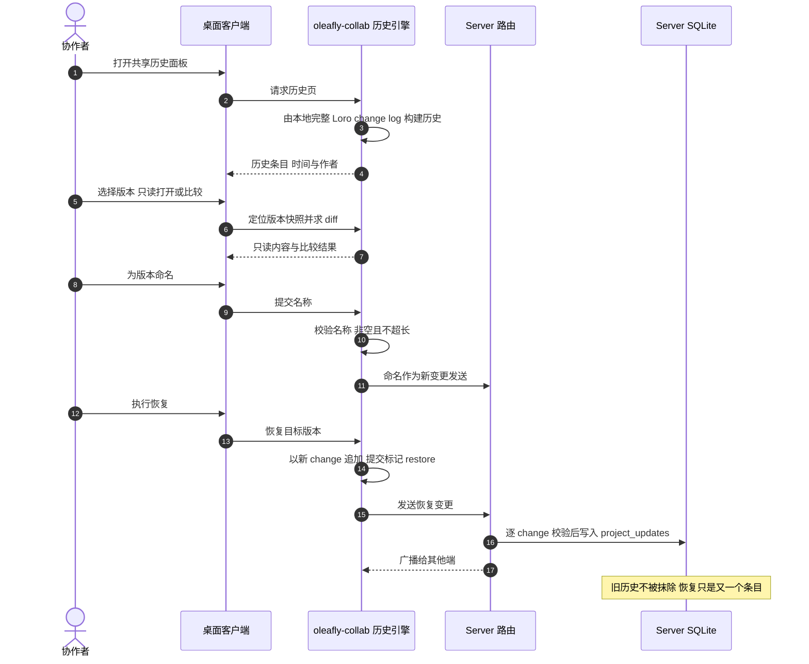

## ADDED — S35 共享历史与版本恢复 场景实现（现状基线）

> module: collab | 场景编号: S35（全局唯一，见 `core-00-scenario-overview.md` 编号注册表） | 优先级: P0
> 基线口径：桌面 0.4.11，绑定提交 `9c307bf3c`（HEAD，领先 `v0.4.11` 标签 3 个提交）
> 本文档为存量产品现状基线：只描述已实现行为，事实来源为提案 `logos/changes/add-baseline-docs/inventory.md` collab 段（S35 行与该段引言）与 `deltas/prd/1-product-requirements/collab-01-requirements.md` §四 S35 章节。**本次为只读静态盘点，未执行任何测试**，动态行为在 verify 阶段单独取证。
> 本文档不新增功能、不修复文档偏差，基线一律以实现为准。

### 一、触发与前置

- **触发条件**：团队需要回溯或恢复共同编辑的某个版本（需求文档 S35 触发条件）。
- **前置条件**：
  - 项目已共享且本地持有**完整的 Loro change log**——共享历史由本地完整 change log 构建，而非由 Server 单独保存的历史表；
  - 目标版本必须是本地 change log 中存在的版本，否则不可用；
  - 命名版本需要写权限（可编辑角色）；**Reviewer 可查看历史但不能恢复**；
  - 版本名称有约束：去空白后不得为空，且不得超过长度上限（超限按过大拒绝）；
  - 项目内容在 Server 侧**不是端到端加密**（capability 明确 `encryption=None`），历史同样如此。

### 二、参与者

| 参与者 | 形态 | 职责 | 证据 |
|---|---|---|---|
| 桌面客户端 | Tauri 桌面应用 | 共享历史面板、版本只读打开/比较/命名、恢复操作入口 | `src/features/collab/sharing/SharedHistory.tsx`；`HistoryCompareDialog.tsx`、`HistoryVersionDialog.tsx` |
| oleafly-collab | Rust crate（历史引擎） | 由本地 Loro change log 构建历史页、按版本定位文档快照、命名/取消命名、以新 change 追加恢复 | `crates/oleafly-collab/src/history.rs` L16-395（`history` / `name_version` / `restore_text` / `restore_node`） |
| Server 路由 | Rust crate `oleafly-server` | 逐 change 校验角色（决定恢复变更能否落地）、广播恢复产生的变更 | `crates/oleafly-server/src/role_guard.rs`；`crates/oleafly-server/src/routes/ws.rs` |
| SQLite | Server 数据库（migration 0001-0018） | 保存完整 change log（`project_updates`）与快照（`project_snapshots`），恢复作为**新变更**追加其中 | `crates/oleafly-server/migrations/0002_projects.sql` |
| 浏览器端 | 浏览器应用 `web/` | **本场景不参与**：浏览器端历史面板能力不在本基线范围；差异见 S40 | `inventory.md` collab 段 S40 行 |

### 三、主时序

1. **桌面客户端** — 协作者打开共享历史面板；引擎从**本地完整 Loro change log** 构建历史页（按时间与作者归并条目）。
2. **oleafly-collab** — 用户选择某个版本：可**只读打开**该版本内容，或与当前版本**比较**（diff）。
3. **oleafly-collab** — 用户为某版本**命名**：名称去空白后不得为空、不得超长；命名以文档内的版本映射写入并提交，成为一条新变更。
4. **oleafly-collab** — 用户执行**恢复**：把目标版本内容作为**新的 change** 追加（提交消息标记为 restore），当前内容被替换为该版本内容。
5. **Server 路由 / SQLite** — 恢复产生的新变更经逐 change 角色校验后写入 `project_updates` 并广播；**旧历史不被抹除**，恢复只是历史中的又一个条目。
6. **桌面客户端** — 其他端收到恢复变更并同步更新；历史面板上可看到「恢复」这一独立条目。
7. **oleafly-collab** — 需要时用户可取消命名（`unname_version`）。

### 四、失败与降级分支

逐条对应需求文档 `collab-01-requirements.md` §四 S35 验收条件中的「异常」与「边界」：

| 分支 | 触发条件 | 行为（基线口径） | 证据 |
|---|---|---|---|
| 本地无目标版本 | 本地 change log 不含目标版本（frontiers 解码失败） | 返回 **`history_unavailable`**，**不凭空构造内容** | `inventory.md` collab 段 S35 行；`crates/oleafly-collab/src/history.rs`（`history_unavailable` / `decode_frontiers`） |
| Reviewer 恢复 | Reviewer 尝试恢复历史版本 | **拒绝**：Reviewer 可查看历史但不能恢复（恢复需要可编辑角色）；服务端逐 change 校验亦会拒绝不匹配的恢复变更 | `inventory.md` collab 段 S35 行；`crates/oleafly-server/src/role_guard.rs`；`src/features/collab/roles.ts`（`canEditProjectRole`） |
| 空名称 | 用户输入空白名称 | **拒绝**（去空白后为空即视为无效名称） | `inventory.md` collab 段 S35 行；`crates/oleafly-collab/src/history.rs`（`checked_name`） |
| 超长名称 | 用户输入超长名称 | **拒绝**（超过长度上限按过大处理） | `inventory.md` collab 段 S35 行；`crates/oleafly-collab/src/history.rs`（`checked_name`） |
| 恢复后历史 | 恢复完成 | **旧历史不被抹除**——恢复以新 change 形式追加，旧版本仍可在历史中查看 | `inventory.md` collab 段 S35 行；`crates/oleafly-collab/src/history.rs` L16-395 |
| 文档冻结 | 项目因错误停止同步而冻结 | 拒绝写入类操作（含命名与恢复），提示需重新打开项目 | `crates/oleafly-collab/src/doc.rs`（`writable`） |
| 保密性边界 | 用户评估托管风险 | Server 侧 `encryption=None`，**项目内容与历史都不是端到端加密**；历史随 change log 存在服务端与各成员副本 | `inventory.md` collab 段引言；`docs/collaboration-server.md` L1-28 |

### 五、边界与证据

- **构建边界**：共享历史由**本地完整 Loro change log** 构建；服务端不另建一套历史真相，本地缺版本即不可用。
- **恢复语义边界**：恢复是**追加新 change**，不是回滚——旧历史条目仍在，历史面板上体现为「恢复」这一条目。
- **权限边界**：查看 ≠ 恢复。Reviewer 可查看/比较历史，但恢复需要可编辑角色；最终裁决仍在服务端逐 change 校验（客户端 UI 不是安全边界）。
- **命名边界**：名称校验是「去空白后非空 + 不超长」两项，其余规则不由本基线推断。
- **协议与通道边界**：会话按 **collab protocol v1 的 min/max 协商**确定，不兼容即停止同步（S29）；桌面端 WS 失败两次后回退 long-poll 并按退避重连（S31），浏览器端只有 WS 重连、无 long-poll 回退（S40）。
- **本场景不做**：合并结果的人工二选一审查（S32）、评论建议聊天（S34）、服务端备份恢复（S39）、浏览器端历史能力（S40）。
- **实现证据**（引自 `inventory.md` collab 段 S35 行）：
  - `collab/history.rs` L16-395（历史页构建、版本定位、命名校验、恢复为新 change）；
  - `SharedHistory.test.tsx` L88-187（历史面板与恢复交互）；
  - `docs/collaboration-server.md` L878-882（共享历史的产品口径）。
- **动态验证声明**：本基线为静态盘点，上述行为**未在本次执行任何测试**；需在 verify 阶段取证，不得预填 PASS。
