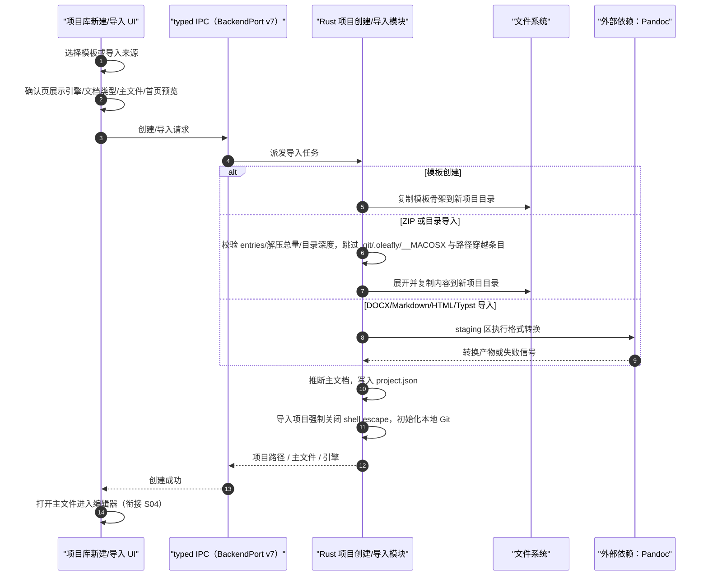

## ADDED — S01 从模板或外部资料创建研究项目 场景实现（现状基线）

> **基线口径**：桌面 0.4.11，绑定提交 `9c307bf3c`（HEAD，领先 `v0.4.11` 标签 3 个提交）；本文件为**只读静态盘点**产物，未运行任何测试。
> **事实来源**：提案 `inventory.md` core 段 S01 行；`deltas/prd/1-product-requirements/core-01-requirements.md` S01 节；`deltas/prd/2-product-design/1-feature-specs/core-01-feature-specs.md` S01 节。
> **本文性质**：存量实现的场景时序基线。只记录已存在的调用链与边界，不新增交互、不发明实现细节；实现与文档的偏差按**实现现状**记录。
> **调用面记号**：`【UI】` 前端界面 ／ `【typed IPC】` 前端↔Rust 结构化调用面 ／ `【Rust】` Rust 进程内模块 ／ `【引擎进程】` 外部编译/转换进程 ／ `【文件系统】` 本地磁盘 ／ `【外部依赖】` 进程外的第三方程序与网络资源。

### 一、触发与前置

- **触发条件**：用户需要开始一份新文稿，或把既有材料（ZIP、DOCX、Markdown、HTML、Typst、文件夹）带入 Oleafly。
- **用户价值**：一分钟内获得可编译、可继续写作的独立项目（痛点 P01 工具链碎片化）。
- **入口**：项目库的新建/导入流程（模板选择与导入来源输入）。
- **前置条件**：
  - 应用已启动且项目库可用，新建/导入入口可被打开。
  - 模板路径：内置/自定义模板条目存在且可读。
  - 导入路径：源材料在本地可读；DOCX/Markdown/HTML/Typst 路线要求本机 Pandoc 可用（否则进入失败分支 F4）。
  - 目标位置可写；导入产物是**独立项目目录**，导入内容复制而非引用。
- **本场景不覆盖**：arXiv / Git 仓库导入（S02）、项目库检索与恢复（S03）、导入后的写作（S04）与编译（S07）。

### 二、参与者

| 参与面 | 组件 | 职责 | 证据 |
|---|---|---|---|
| 前端 UI | 项目库新建/导入流程：模板选择（空白/内置/自定义）、导入来源选择（ZIP/DOCX/Markdown/HTML/Typst/目录）、确认前预览页 | 收集模板或来源输入；展示引擎、文档类型、主文件与首页预览；用户确认后才推进 | docs/ProjectLibrary.md L12-38；docs/Templates.md L7-52；ProjectImportDialog.test.tsx L419-478 |
| typed IPC | BackendPort v7（12 capabilities）调用面 | 前端向 Rust 侧发出项目创建/导入命令，接收结构化结果（含错误码如 `tools.pandoc_missing`） | inventory.md「架构与测试要点·API 资产」；Tauri IPC 注册表 lib.rs L523-1251 |
| Rust 模块 | 项目创建与导入模块（project.rs） | 解析模板与来源、展开/复制导入内容、推断主文档、写 `project.json`、生成独立项目目录、强制关闭 shell escape、初始化本地 Git | project.rs L5489-5764；project.rs L6905-7126 |
| 引擎进程 | 声明引擎（Tectonic / latexmk / Typst / Pandoc 路线） | **本场景不拉起引擎进程**：确认页只展示声明引擎与首页预览；真正编译由 S07 承接 | docs/Templates.md L7-52；inventory.md core 段 S01 行 |
| 文件系统 | 本地源材料目录/文件、目标项目目录 | 读取源材料、写出新项目目录；原件只读不改（复制语义） | project.rs L5489-5764 |
| 外部依赖 | Pandoc（DOCX/Markdown/HTML/Typst 转换） | 在 staging 区完成格式转换；不可用或失败时按错误码返回 | project.rs L6905-7126 |

### 三、主时序

1. `【UI】` 用户在项目库进入新建/导入流程，选择模板（空白/内置/自定义）或导入来源（ZIP / DOCX / Markdown / HTML / Typst / 目录）。
2. `【UI】` 确认前预览页展示**引擎、文档类型、主文件、首页预览**，用户确认后才继续。
3. `【typed IPC】` 前端提交创建/导入请求（模板标识 或 来源路径 + 引擎声明）。
4. `【Rust】` 解析请求并按来源分流：模板 → 复制模板骨架；ZIP/目录 → 展开并复制；DOCX/Markdown/HTML/Typst → 进入 Pandoc staging。
5. `【Rust】` / `【文件系统】` 校验并执行导入约束：ZIP entries ≤ 5000、解压总量 ≤ 2 GiB、目录深度 ≤ 16；跳过 `.git` / `.oleafly` / `__MACOSX` 与路径穿越条目。
6. `【Rust】` 推断主文档（单根目录 ZIP 自动展开并推断主文档），写入 `project.json`（引擎、文档类型、主文件）。
7. `【Rust】` 导入项目**强制关闭 shell escape**；初始化本地 Git（首提交失败不留伪基线，见 S13）。
8. `【文件系统】` 生成独立项目目录，导入内容复制进新项目，原件未被修改。
9. `【typed IPC】` 返回创建结果（项目路径、主文件、引擎）。
10. `【UI】` 打开主文件进入编辑器，衔接 S04。

### 四、失败与降级分支

| # | 触发 | 系统行为（实现现状） | 对应需求验收条件 |
|---|---|---|---|
| F1 | ZIP 超过 5000 entries / 2 GiB 解压总量 / 目录深度 16 | 导入失败并明确报错，**不留下半成品项目** | 异常：ZIP 超限或不可读 |
| F2 | ZIP 或目录不可读 | 同 F1：明确报错，无半成品残留 | 异常：ZIP 超限或不可读 |
| F3 | 归档内含 `.git` / `.oleafly` / `__MACOSX` 或路径穿越条目 | 跳过这些条目，不写入项目目录 | 异常：ZIP 超限或不可读 |
| F4 | 导入 DOCX/Markdown/HTML/Typst 而 Pandoc 不可用 | 返回 `tools.pandoc_missing` 明确错误，**不创建项目** | 异常：Pandoc 缺失 |
| F5 | Pandoc 转换失败 | 保留输入（原件与 staging 输入不丢），可重试 | inventory.md S01 行「转换失败保留输入可重试」 |
| F6 | 用户删除所用模板 | 不影响已创建的项目 | inventory.md S01 行「删模板不影响已建项目」 |
| F7 | 导入项目被迁移到新位置 | shell escape 仍为关闭态；信任须重新授予（与 S07 的信任边界一致） | S01 强制关闭 shell escape；S07 边界：shell escape 信任 |

**降级通则**：本场景的失败一律以**显式错误**结束，不静默降级为「创建了空项目」。

### 五、边界与证据

**边界**

- 导入**不改原件**：内容复制进新项目目录，原文件未被修改。
- 单根目录 ZIP 自动展开并推断主文档。
- 导入项目强制关闭 shell escape；本地 Git 初始化。
- 跳过 `.git` / `.oleafly` / `__MACOSX` 与路径穿越条目。
- ZIP 上限：5000 entries / 2 GiB 解压总量 / 目录深度 16。
- 模板删除不影响已建项目；转换失败保留输入可重试。
- 本场景不触发引擎进程：引擎只被声明与预览，编译由 S07 承接。

**证据（inventory.md core 段 S01 行）**

- docs/ProjectLibrary.md L12-38；docs/Templates.md L7-52
- ProjectImportDialog.test.tsx L419-478
- project.rs L5489-5764（ZIP 限 5000 entries/2GiB/深度 16，跳过 .git/.oleafly，shell escape 强制关）
- project.rs L6905-7126（Pandoc staging，`pandoc_missing` / `import_failed`）
