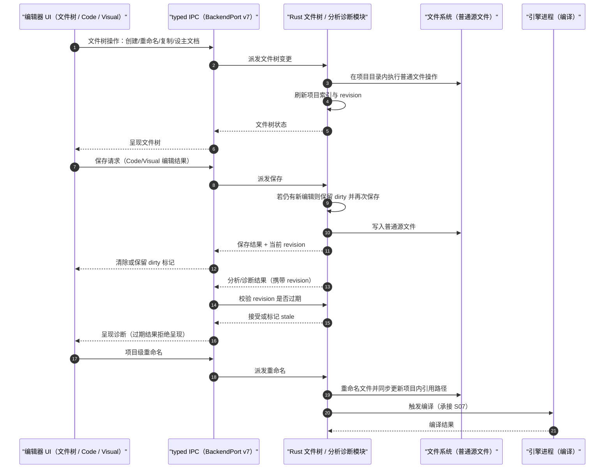

## ADDED — S04 多文件研究写作（源码/可视） 场景实现（现状基线）

> **基线口径**：桌面 0.4.11，绑定提交 `9c307bf3c`（HEAD，领先 `v0.4.11` 标签 3 个提交）；本文件为**只读静态盘点**产物，未运行任何测试。
> **事实来源**：提案 `inventory.md` core 段 S04 行；`deltas/prd/1-product-requirements/core-01-requirements.md` S04 节；`deltas/prd/2-product-design/1-feature-specs/core-01-feature-specs.md` S04 节。
> **本文性质**：存量实现的场景时序基线。只记录已存在的调用链与边界，不新增交互、不发明实现细节。
> **调用面记号**：`【UI】` 前端界面 ／ `【typed IPC】` 前端↔Rust 结构化调用面 ／ `【Rust】` Rust 进程内模块 ／ `【引擎进程】` 外部编译/转换进程 ／ `【文件系统】` 本地磁盘 ／ `【外部依赖】` 进程外的第三方程序与网络资源。

### 一、触发与前置

- **触发条件**：日常撰写与组织多文件文稿。
- **用户价值**：在一个工作区内完成结构组织、撰写与项目级智能（痛点 P01 工具链碎片化）。
- **入口**：编辑器——文件树与 Code / Visual 两种撰写模式。
- **前置条件**：
  - 项目已创建并打开（S01 已产出项目目录与 `project.json`）。
  - 项目是**普通目录**：源文件以普通文件形式存在于磁盘，无隐藏副本。
  - 写作链路默认本地执行，跨模块能力（文献、协作、AI）不属于本场景。
- **本场景不覆盖**：拼写语法校对（S05）、图表绘制（S06）、编译执行（S07）、检查点（S12）。

### 二、参与者

| 参与面 | 组件 | 职责 | 证据 |
|---|---|---|---|
| 前端 UI | 编辑器：文件树（增删改、主文档选择）、Code 模式（补全、结构视图、引用/标签检查、数学/图/表预览）、Visual 模式、诊断呈现、项目级重命名 | 承载撰写交互、呈现结构视图与诊断、发起文件树操作与重命名 | docs/General.md L9-20；docs/Editor.md L8-76, L93-102, L111-174, L371-376 |
| typed IPC | BackendPort v7（12 capabilities）调用面 | 前端向 Rust 侧发出文件树操作、保存、诊断查询等结构化请求与订阅 | inventory.md「架构与测试要点·API 资产」；Tauri IPC 注册表 lib.rs L523-1251 |
| Rust 模块 | 文件树与项目索引模块、分析/诊断模块、项目级重命名模块 | 增删改查文件树、设置主文档、写入普通源文件、计算并携带 revision 的诊断/分析结果、同步项目内引用路径 | docs/Editor.md L93-102, L111-174, L371-376；files.test.ts L346-399 |
| 引擎进程 | 编译引擎 | **仅在项目级重命名后被触发编译**；本场景其余路径不拉起引擎 | inventory.md core 段 S04 行「项目级重命名后触发编译」 |
| 文件系统 | 项目目录内的普通源文件 | 承载全部编辑结果（唯一权威数据源，无隐藏副本） | docs/General.md L9-20；docs/Editor.md L8-76 |
| 外部依赖 | 无强制外部依赖 | 本场景全程本地执行；编辑器能力契约以 `test/fixtures/editor-support/contract.json` 为准 | core-01-requirements.md 5.1 技术约束 |

### 三、主时序

1. `【UI】` 在文件树创建 / 重命名 / 复制文件，并指定主文档。
2. `【typed IPC】` → `【Rust】` 提交文件树变更（新增/重命名/复制/设主文档）。
3. `【文件系统】` `【Rust】` 在项目目录内完成对应的普通文件操作，刷新项目索引。
4. `【UI】` 在 Code 或 Visual 模式撰写：补全、结构视图、引用/标签检查、数学/图/表预览。
5. `【typed IPC】` → `【Rust】` 保存请求；`【文件系统】` 把修改写入**普通源文件**。
6. `【UI】` 自动保存定时器触发；`【Rust】` 校验保存时是否仍有新编辑：若仍有新编辑，**dirty 状态保留并再次保存**，不丢失输入。
7. `【Rust】` 后台计算分析/诊断，结果携带**项目 revision** 返回。
8. `【UI】` 若返回结果的 revision 已过期，则**拒绝呈现**，不误导当前编辑状态。
9. `【UI】` 发起项目级重命名（文件被其他文件引用）→ `【Rust】` 同步更新项目内指向该文件的路径。
10. `【Rust】` → `【引擎进程】` 触发编译（承接 S07）。
11. `【Rust】` 处理 `%novalidate` 语义：仅关闭相应**语法检查**，编译错误、拼写、语法与引用检查仍继续。

### 四、失败与降级分支

| # | 触发 | 系统行为（实现现状） | 对应需求验收条件 |
|---|---|---|---|
| F1 | 自动保存触发时用户仍有新编辑 | dirty 状态**保留**并再次保存，不丢失输入 | 正常：多文件撰写与保存 |
| F2 | 项目状态已变化，旧 revision 的分析/诊断结果返回 | 结果**被拒绝呈现**，不误导当前编辑状态 | 异常：过期分析结果 |
| F3 | 源文件含 `%novalidate` 或区域标记 | **仅关闭相应语法检查**；编译错误、拼写、语法与引用检查仍继续 | 边界：`%novalidate` 语义 |
| F4 | 项目级重命名目标文件被其他文件引用 | 项目内指向它的路径**同步更新**，重命名后触发编译 | 正常：项目级重命名 |
| F5 | 拼写/语法/引用检查所需组件不可用 | 由 S05/S08 承接：语言未安装时明确报告不回退；不静默跳过检查 | 核心-01-requirements.md S05 异常：语言未安装 |

**降级通则**：过期结果宁可不呈现，也不呈现错位结果；`%novalidate` 只降级语法检查一项，不降级其他检查。

### 五、边界与证据

**边界**

- 所有修改写入**普通源文件**，不产生隐藏副本；项目始终是可被任意编辑器打开的普通目录。
- 自动保存不丢输入（dirty 再存）。
- 旧 revision 的分析/诊断结果拒绝呈现。
- `%novalidate` 只关语法检查，编译/拼写/语法/引用检查仍继续。
- 项目级重命名同步更新项目内引用路径，并触发编译。
- 编辑器能力验收契约以 `test/fixtures/editor-support/contract.json` 为准。
- 本场景不拉起引擎进程（除重命名后的触发编译）。

**证据（inventory.md core 段 S04 行）**

- docs/General.md L9-20
- docs/Editor.md L8-76, L93-102, L111-174, L371-376
- files.test.ts L346-399
