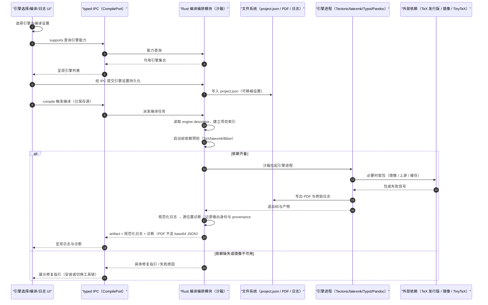

## ADDED — S07 编译引擎选择与工具链修复 场景实现（现状基线）

> **基线口径**：桌面 0.4.11，绑定提交 `9c307bf3c`（HEAD，领先 `v0.4.11` 标签 3 个提交）；本文件为**只读静态盘点**产物，未运行任何测试。
> **事实来源**：提案 `inventory.md` core 段 S07 行与「架构与测试要点·编译主链路」；`deltas/prd/1-product-requirements/core-01-requirements.md` S07 节；`deltas/prd/2-product-design/1-feature-specs/core-01-feature-specs.md` S07 节。
> **本文性质**：存量实现的场景时序基线。只记录已存在的调用链与边界，不新增交互、不发明实现细节。
> **调用面记号**：`【UI】` 前端界面 ／ `【typed IPC】` 前端↔Rust 结构化调用面（CompilePort） ／ `【Rust】` Rust 进程内模块 ／ `【引擎进程】` 外部编译进程 ／ `【文件系统】` 本地磁盘 ／ `【外部依赖】` 进程外的第三方程序与网络资源。

### 一、触发与前置

- **触发条件**：需要产出 PDF。
- **用户价值**：本地、可复现地编译，出问题时能自我修复（痛点 P02 编译环境配置复杂）。
- **入口**：编译入口中的引擎选择与编译设置。
- **前置条件**：
  - 项目已存在并声明引擎（`project.json` 中持久化引擎与可移植设置）。
  - 编译只针对**已保存的源**；编辑器有未保存改动时需先保存。
  - 所选工具链在本机可用，否则进入失败分支 F1/F2/F3。
- **本场景不覆盖**：可复现代码文档（Quarto/Calepin，S08）、PDF 预览与 SyncTeX 定位（S09）。

### 二、参与者

| 参与面 | 组件 | 职责 | 证据 |
|---|---|---|---|
| 前端 UI | 引擎选择与编译设置面板、编译触发按钮、规范化日志与源位置诊断视图、依赖安装/切换指引 | 选引擎与设置、发起编译、呈现日志/诊断、把修复指引暴露给用户 | docs/CompilationEngines.md L18-134, L272-345；e2e/tests/02-create-compile.spec.ts L23-43 |
| typed IPC | CompilePort（`supports` / `compile` / `stop` / `syncTex`） | 前端向 Rust 侧查询引擎能力、发起编译、停止编译、请求同步定位 | inventory.md「架构与测试要点·API 资产」；Tauri IPC 注册表 lib.rs L523-1251 |
| Rust 模块 | 编译编排模块（engine descriptor 解析、项目索引、沙箱化引擎进程启动、shell escape 信任判定、输出身份/provenance 记录、日志规范化与诊断生成） | 把声明的引擎描述符落为可执行编译；产出 PDF artifact、规范化日志与源位置诊断；判定工具链依赖是否齐备 | inventory.md「架构与测试要点·编译主链路」；docs/CompilationEngines.md L18-134, L272-345 |
| 引擎进程 | Tectonic / latexmk / Typst / Markdown(Pandoc) | 实际排版与产出；由 Rust 侧以沙箱方式拉起 | docs/CompilationEngines.md L18-134, L272-345 |
| 文件系统 | `project.json`、PDF artifact、构建缓存/输出目录、shell escape 信任记录（按目录+机器） | 持久化可移植编译设置；保存产物与日志；保存信任授予状态 | docs/CompilationEngines.md L272-345；inventory.md core 段 S07 行 |
| 外部依赖 | TeX 发行版与 latexmk/Biber、Tectonic 镜像与上游源、TinyTeX、Typst 二进制 | 提供排版能力；缺失时按 F1/F2/F3 处理 | docs/CompilationEngines.md L18-134, L272-345 |

### 三、主时序

**编译主链路（inventory.md 口径）**：engine descriptor → 项目索引 → typed IPC → Rust sandbox 引擎 → 规范化日志/诊断/artifact → PDF.js+SyncTeX（后半段由 S09 承接）。

1. `【UI】` 选择编译引擎（Tectonic / latexmk / Typst / Markdown(Pandoc)）与编译设置。
2. `【Rust】` 把可移植设置写入 `project.json`（保证可复现）。
3. `【typed IPC】` CompilePort `supports` 查询引擎能力，UI 呈现可用引擎。
4. `【UI】` 触发编译（已保存源）。
5. `【typed IPC】` CompilePort `compile` 请求 → `【Rust】` 读取 engine descriptor 并建立项目索引。
6. `【Rust】` 启动前做依赖预检：latexmk 路线需要 TeX / latexmk / Biber。
7. `【Rust】` 以沙箱方式拉起 `【引擎进程】`，传入项目目录与设置。
8. `【引擎进程】` 排版；Tectonic 路线在镜像不可用时改试上游。
9. `【引擎进程】` → `【文件系统】` 写出 PDF 与原始日志。
10. `【Rust】` 规范化日志 → 生成带**源位置**的诊断；记录输出的身份与本地构建 provenance。
11. `【Rust】` → `【typed IPC】` 返回 artifact 与诊断；**PDF 不走 base64 JSON**（走文件路径/流式 artifact 通道）。
12. `【UI】` 呈现规范化日志与源位置诊断；按明确提示安装/切换 TeX 发行版、TinyTeX、Typst 或依赖后重试。

### 四、失败与降级分支

| # | 触发 | 系统行为（实现现状） | 对应需求验收条件 |
|---|---|---|---|
| F1 | 选择 latexmk 但 TeX / latexmk / Biber 缺失 | **启动前停止**并给出具体修复指引，不伪装成一般编译失败 | 异常：latexmk 依赖缺失 |
| F2 | Tectonic 配置镜像不可用 | **改试上游并记录** | 异常：Tectonic 镜像失败 |
| F3 | Tectonic 离线且缺缓存文件 | 给出具体消息（明确缺哪个缓存文件） | 异常：Tectonic 镜像失败 |
| F4 | 项目经 `project.json` / ZIP / Git 迁移到新位置 | shell escape 信任**不随迁移**，需在新位置重新授予（信任按目录+机器） | 边界：shell escape 信任 |
| F5 | 编译被用户中止 | CompilePort 提供 `stop`；本场景不静默产出半成品结果 | inventory.md API 资产：CompilePort `supports/compile/stop/syncTex` |

**降级通则**：工具链问题必须在**启动前**或**明确镜像失败点**被识别并给出可执行的修复指引；不得把依赖缺失伪装成普通编译失败。

### 五、边界与证据

**边界**

- 引擎设置持久化于 `project.json`，保证可复现。
- 产出 PDF、规范化日志与源位置诊断三件套；PDF 保留本地构建 provenance（输出身份）。
- PDF **不走 base64 JSON** 传输。
- shell escape 信任按目录+机器授予，不随 `project.json`、ZIP 或 Git 迁移。
- 引擎能力以 `DocumentEngine` 描述符为唯一事实源（core-01-requirements.md 5.1）。

**证据（inventory.md core 段 S07 行）**

- docs/CompilationEngines.md L18-134, L272-345
- e2e/tests/02-create-compile.spec.ts L23-43
- inventory.md「架构与测试要点·编译主链路」：engine descriptor → 项目索引 → typed IPC → Rust sandbox 引擎 → 规范化日志/诊断/artifact → PDF.js+SyncTeX；PDF 不走 base64 JSON
- inventory.md「API 资产」：CompilePort（supports/compile/stop/syncTex）；Tauri IPC 注册表 lib.rs L523-1251
