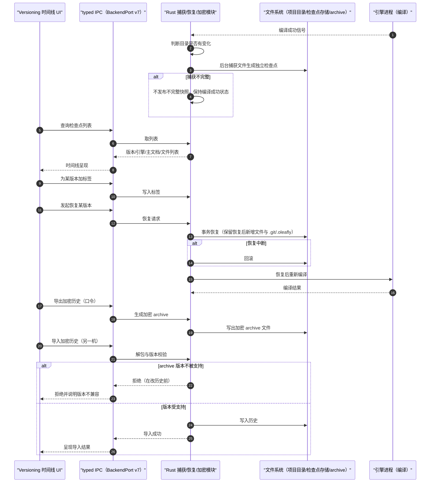

## ADDED — S12 检查点恢复与加密迁移 场景实现（现状基线）

> **基线口径**：桌面 0.4.11，绑定提交 `9c307bf3c`（HEAD，领先 `v0.4.11` 标签 3 个提交）；本文件为**只读静态盘点**产物，未运行任何测试。
> **事实来源**：提案 `inventory.md` core 段 S12 行；`deltas/prd/1-product-requirements/core-01-requirements.md` S12 节；`deltas/prd/2-product-design/1-feature-specs/core-01-feature-specs.md` S12 节。
> **本文性质**：存量实现的场景时序基线。只记录已存在的调用链与边界，不新增交互、不发明实现细节。
> **调用面记号**：`【UI】` 前端界面 ／ `【typed IPC】` 前端↔Rust 结构化调用面 ／ `【Rust】` Rust 进程内模块 ／ `【引擎进程】` 编译引擎 ／ `【文件系统】` 本地磁盘 ／ `【外部依赖】` 进程外的第三方程序与网络资源。

### 一、触发与前置

- **触发条件**：误改需回退，或迁移到新机。
- **用户价值**：每次成功编译都有可回退快照（痛点 P03 版本安全与可恢复性差）。
- **入口**：Versioning 时间线。
- **前置条件**：
  - 项目已存在且至少成功编译过一次（捕获时机是「成功编译」信号）。
  - 成功编译后**项目目录有变化**才会生成独立检查点；无变化不产生新检查点。
  - 检查点存储与本地 Git **完全独立**，互不替代。
- **本场景不覆盖**：本地 Git 版本管理与发布（S13）、PDF 预览的检查点语义（S09 F6）。

### 二、参与者

| 参与面 | 组件 | 职责 | 证据 |
|---|---|---|---|
| 前端 UI | Versioning 时间线（版本、引擎、主文档、文件列表、标签）、恢复操作、加密导出/导入对话框、Keep latest / Reset 清理 | 展示检查点元信息与文件、添加标签、发起恢复、发起加密导出/导入与清理 | docs/Checkpoints.md L7-134；e2e/66-checkpoints.spec.ts L90-194 |
| typed IPC | BackendPort v7（12 capabilities）调用面 | 前端向 Rust 侧查询检查点列表、发起恢复/导出/导入/清理 | inventory.md「架构与测试要点·API 资产」；Tauri IPC 注册表 lib.rs L523-1251 |
| Rust 模块 | 捕获调度模块（checkpoints.rs）、不完整捕获判定模块、恢复事务模块、加密 archive 版本协商模块 | 在成功编译后调度后台快照；判定捕获是否完整；事务化恢复（中断回滚）；加密历史的打包/解包与版本校验 | checkpoints.rs L724-776；docs/Checkpoints.md L7-134 |
| 引擎进程 | 编译引擎 | 只提供「编译成功」信号与编译状态；检查点不由引擎产出 | docs/Checkpoints.md L7-134；inventory.md core 段 S12 行 |
| 文件系统 | 项目目录、检查点存储目录 | 被快照的项目文件；独立于 `.git` 的检查点归档；加密 archive 文件 | docs/Checkpoints.md L7-134；inventory.md「数据资产」：catalog.sqlite3（checkpoint format 2） |
| 外部依赖 | 无强制外部依赖 | 加密历史迁移为本地 archive 文件；跨机迁移由用户搬运文件 | docs/Checkpoints.md L7-134 |

### 三、主时序

1. `【Rust】` 收到 `【引擎进程】` 的编译成功信号。
2. `【Rust】` 检查项目目录相对上次捕获是否有变化；有变化则在**后台**生成独立检查点，无变化不生成。
3. `【Rust】` 捕获文件；判定捕获完整性：部分文件无法完整捕获 → **不发布不完整快照**，且**不把成功编译改为失败**；新编译开始时**取消旧捕获**且不误报（见 F1/F2）。
4. `【typed IPC】` 查询检查点列表 → `【UI】` 时间线展示版本、引擎、主文档与文件列表。
5. `【UI】` 用户为某个版本**加标签**。
6. `【UI】` 选择某版本恢复 → `【typed IPC】` → `【Rust】` 以**事务**方式恢复：项目回到该版本，**恢复之后新增的文件与 `.git` / `.oleafly` 保留**；中断则回滚（见 F3）。
7. `【Rust】` → `【引擎进程】` 恢复后重新编译。
8. `【UI】` 发起加密历史导出（口令）→ `【typed IPC】` → `【Rust】` 生成加密 archive 文件。
9. 用户在另一台机器导入该 archive → `【Rust】` 校验 archive 版本：**由更新版本创建的 archive，旧版本导入时在改历史前拒绝**（见 F4）。
10. `【UI】` 可用 Keep latest / Reset 清理检查点历史。

### 四、失败与降级分支

| # | 触发 | 系统行为（实现现状） | 对应需求验收条件 |
|---|---|---|---|
| F1 | 部分文件无法完整捕获 | **不发布不完整快照**；**不把成功编译改为失败** | 异常：不完整捕获 |
| F2 | 新编译开始，旧捕获尚未完成 | **取消旧捕获**，且不误报（不产生虚假失败/虚假检查点） | 异常：不完整捕获 |
| F3 | 恢复过程被中断 | 恢复是**事务**，**回滚**到恢复前状态 | 正常：检查点与恢复 |
| F4 | 导入由更新版本 Oleafly 创建的加密 archive | **在改历史前拒绝** | 异常：加密历史 |
| F5 | archive 版本不受支持 | 拒绝导入，不改动本地历史 | 异常：加密历史 |
| F6 | 用户忘记导出口令 | **不可恢复**（明确边界，无后门） | 异常：加密历史 |
| F7 | 恢复到的版本之后用户新增过文件 | 恢复后**新增的文件与 `.git` / `.oleafly` 保留** | 正常：检查点与恢复 |

**降级通则**：宁可少一个检查点，也不发布不完整快照；恢复要么完整成功、要么整体回滚。

### 五、边界与证据

**边界**

- 成功编译**且目录有变化**时才后台生成独立检查点。
- 不完整捕获不发布；新编译取消旧捕获且不误报。
- 恢复是事务，中断回滚；恢复之后新增的文件与 `.git` / `.oleafly` 保留。
- 加密 archive 版本不受支持时在改历史前拒绝；忘记密码不可恢复。
- 检查点存储与 Git **完全独立**，互不替代。
- 与 S09 的关系：失败编译的 best-effort PDF **不更新**最后成功检查点。

**证据（inventory.md core 段 S12 行）**

- docs/Checkpoints.md L7-134
- e2e/66-checkpoints.spec.ts L90-194
- checkpoints.rs L724-776
- inventory.md「数据资产」：本地五库含 catalog.sqlite3（checkpoint format 2）
