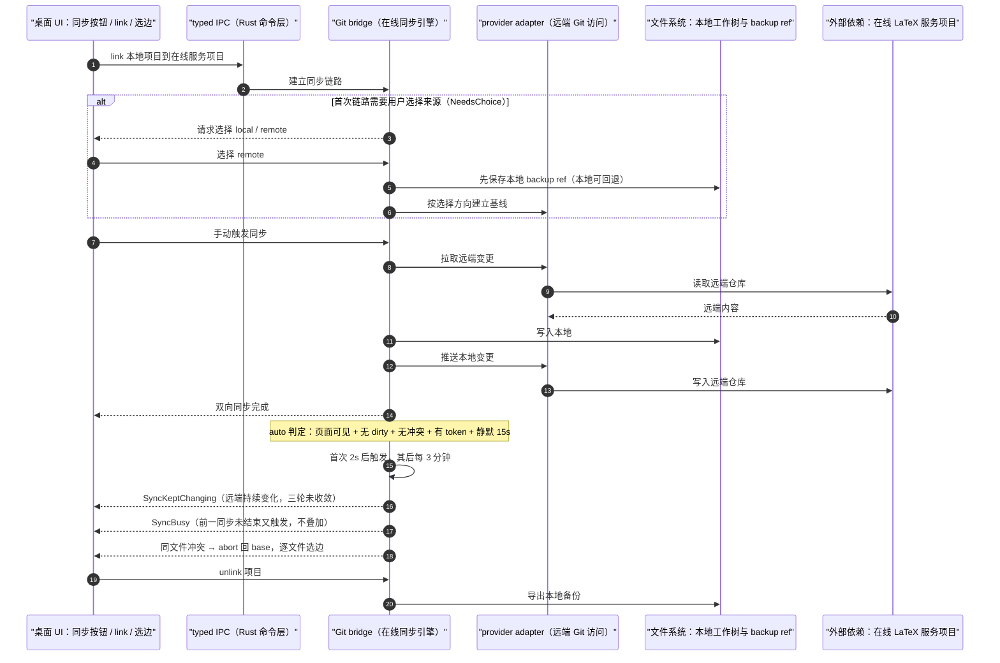

## ADDED — S48 在线服务 Git 桥双向同步 场景实现（现状基线）

> **基线口径**：桌面 `0.4.11`，绑定提交 `9c307bf3c`（HEAD，领先 `v0.4.11` 标签 3 个提交）；本文件为**只读静态盘点**产物，未运行任何测试。
> **事实来源**：提案 `inventory.md` sync 段 S48 行；`deltas/prd/1-product-requirements/sync-01-requirements.md` S48 节；`deltas/prd/2-product-design/1-feature-specs/sync-01-feature-specs.md` S48 节。
> **本文性质**：存量实现的场景时序基线。只记录已存在的调用链与边界，不新增交互、不发明实现细节；实现与文档的偏差按**实现现状**记录。
> **口径声明（不可混称）**：**云同步 ≠ 实时协作**，二者是**两套正交机制**。本场景是**本地项目与在线 LaTeX 服务（实现内部称 overleaf）项目之间经 Git 桥的双向同步**，属 sync 模块；它既不是 collab 模块的实时协作（S29-S42），也不是 Dropbox/Drive/S3 的云存储同步路径（S43）。三者不可混称。
> **调用面记号**：`【UI】` 前端界面 ／ `【typed IPC】` 前端↔Rust 结构化调用面 ／ `【Rust】` Rust 进程内模块 ／ `【文件系统】` 本地磁盘 ／ `【外部依赖】` 进程外的在线服务与网络资源。

### 一、触发与前置

- **触发条件**：本地项目与在线 LaTeX 服务上的对应项目需要保持一致。
- **用户价值**：不经手工搬运，本地与在线双向同步（痛点 P03 在线平台锁定）。
- **入口**：在线服务同步按钮（`OverleafSyncButton.tsx`）、项目的 link / unlink 操作、auto 同步的周期判定。
- **前置条件**：
  - 项目已 **link** 到在线服务上的对应项目。
  - 存在可用 **token**（auto 同步的必要条件之一）。
  - auto 同步还需：页面可见、无 dirty 编辑、无未解决冲突、**静默 15 秒**。
- **本场景不覆盖**：在线服务项目批量导入（S47）、云存储账户连接与范围判定（S43）、外部连接器凭据安全（S49）、实时协作（S29-S42）。

### 二、参与者

| 参与面 | 组件 | 职责 | 证据 |
|---|---|---|---|
| 桌面 UI | 在线服务同步按钮（`OverleafSyncButton.tsx`）、link / unlink 操作界面、冲突逐文件选边界面 | 触发手动同步与 link/unlink；呈现 auto 同步状态、冲突选边与错误分类 | OverleafSyncButton.tsx L35-129 |
| typed IPC | Rust 命令层（在线同步调用面） | 调度 Git 桥同步、回传分类错误（`AlreadyLinked`、`after_files_changed` 等） | oleafly-online/sync/mod.rs L1417-2049 |
| Git bridge | 在线服务 Git 桥同步引擎（oleafly-online/sync/mod.rs） | 执行双向同步、auto 触发条件判定、冲突 abort 回 base 与逐文件选边、NeedsChoice 首链处理、backup ref 保存、unlink 导出备份 | oleafly-online/sync/mod.rs L17-72、L528-560、L1417-2049；sync/tests.rs L360-617、L1200-1219 |
| provider adapter | 远端 Git 访问适配（在线服务项目仓库的读写通道） | 经 Git 协议访问在线服务上的项目仓库；承载 token 的受控使用（token 不进 argv / URL / `.git/config`，见 S49） | oleafly-online/sync/mod.rs L17-72；sync/tests.rs L360-617；inventory.md sync 段 S49 行 |
| 文件系统 | 本地项目工作树与本地 Git 仓库 | 提供被同步内容与 **backup ref** 的存放位置（首链选 remote 前保存） | sync/tests.rs L1200-1219 |
| 外部依赖 | 在线 LaTeX 服务（overleaf）上的对应项目 | 远端同步对端；其持续变化会被同步判定捕捉 | oleafly-online/sync/mod.rs L17-72 |
| （不涉及）实时协作通道 | Loro CRDT / Server（collab 模块） | **本场景完全不涉及**：Git 桥的冲突处理是 abort 回 base 逐文件选边，不是 CRDT 自动合并 | inventory.md collab 段 S29-S42 |

### 三、主时序

1. `【UI】` 用户把本地项目 **link** 到在线服务上的对应项目。
2. `【Git bridge】` 首次同步链路可能进入 **NeedsChoice**，要求用户选择来源：
   - 选择 **remote** 前，**先保存本地 backup ref**（本地内容可回退）；
   - 选择 **local** 则以本地为准建立链路。
3. `【UI】` 用户**手动触发同步** → `【Git bridge】` 执行本地与远端**双向同步**，两端内容趋于一致。
4. `【Git bridge】` **auto 同步条件判定**（五项全部满足才触发）：
   - 页面可见；
   - 无 dirty 编辑；
   - 无冲突；
   - 有可用 token；
   - 已静默 **15 秒**。
5. `【Git bridge】` 条件满足时：**首次在 2 秒后触发**，其后**每 3 分钟**一次。
6. `【UI】` 同一文件在双侧被修改时 → `【Git bridge】` 同步 **abort 回到 base**，由用户**逐文件选边**。
7. `【UI】` 用户 **unlink** 项目 → `【Git bridge】` **导出本地备份**。

### 四、失败与降级分支

| # | 触发 | 系统行为（实现现状） | 对应需求验收条件 |
|---|---|---|---|
| F1 | auto 周期到达，但**页面不可见 / 有 dirty 编辑 / 有未解决冲突 / 无 token** 任一不满足 | **不执行推送**——auto 不是无条件定时推送 | 异常：条件不满足不推送 |
| F2 | 远端在同步期间**持续变化**（三轮未收敛） | 以 **`SyncKeptChanging`** 收尾 | 异常：远端持续变化与并发 |
| F3 | 前一同步尚未结束又触发新同步 | 返回 **`SyncBusy`**，不叠加执行 | 异常：远端持续变化与并发 |
| F4 | 同一文件在双侧被修改 | 同步 **abort 回到 base**，由用户**逐文件选边** | 异常：同文件冲突与首链选择 |
| F5 | 首链 NeedsChoice 且用户选 remote | **选 remote 前先保存本地 backup ref**，本地内容可回退 | 异常：同文件冲突与首链选择 |
| F6 | 项目已 link 后再次 link | 返回 **`AlreadyLinked`** 等分类错误，不混为一般失败 | 边界：unlink 备份与错误分类 |
| F7 | 同步期间本地文件发生变化 | 返回 **`after_files_changed`** 等分类错误 | 边界：unlink 备份与错误分类 |
| F8 | 用户 unlink 项目 | **导出本地备份**后解除链接 | 边界：unlink 备份与错误分类 |

**降级通则**：本场景的异常一律以**分类错误或明确终态**返回（`SyncKeptChanging` / `SyncBusy` / `AlreadyLinked` / `after_files_changed`），不伪装成一般失败，也不静默丢数据。

### 五、边界与证据

**边界**

- **auto 触发条件**：页面可见 + 无 dirty + 无冲突 + 有 token + 静默 **15s**；**首次 2s 后触发，其后每 3 分钟**一次。
- **auto 不是无条件定时推送**：任一条件不满足即不推送。
- 远端持续变化三轮后以 `SyncKeptChanging` 收尾；并发触发返回 `SyncBusy`。
- 同文件冲突 abort 回 base，逐文件选边。
- 首链 NeedsChoice 且选 remote 前保存本地 backup ref。
- unlink 导出本地备份。
- 错误按类型分开返回（`AlreadyLinked`、`after_files_changed` 等），不混为一般失败。
- 现状声明：本文件为静态盘点，未执行任何测试；auto 同步的计时精度与真实在线服务下的动态表现于 verify 阶段单独取证。

**证据（inventory.md sync 段 S48 行）**

- OverleafSyncButton.tsx L35-129（同步按钮与 auto 条件）
- oleafly-online/sync/mod.rs L17-72、L528-560、L1417-2049（同步执行、auto 判定、错误分类）
- sync/tests.rs L360-617、L1200-1219（并发、backup ref 与错误分类测试）
