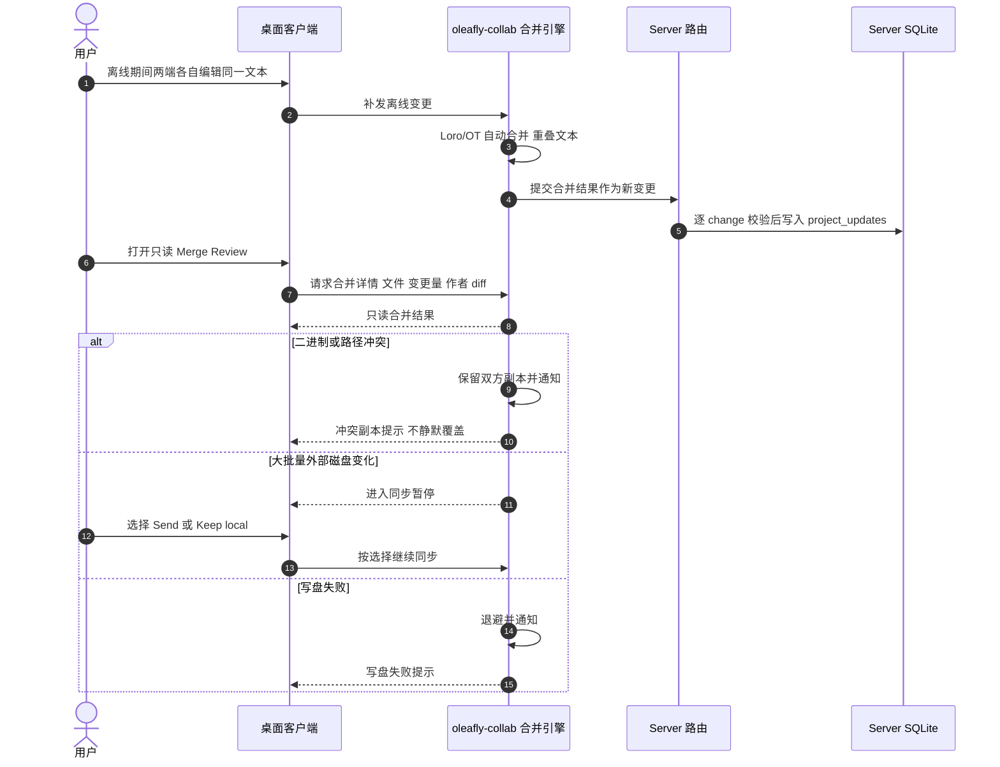

<!-- fix-doc-deviations: D12 标注转终态 -->
## MODIFIED — S32 离线冲突合并与审查 场景实现（现状基线）

> module: collab | 场景编号: S32（全局唯一，见 `core-00-scenario-overview.md` 编号注册表） | 优先级: P0
> 基线口径：桌面 0.4.11，绑定提交 `9c307bf3c`（HEAD，领先 `v0.4.11` 标签 3 个提交）
> 本文档为存量产品现状基线：只描述已实现行为，事实来源为提案 `logos/changes/add-baseline-docs/inventory.md` collab 段（S32 行与该段引言、偏差 D12）与 `deltas/prd/1-product-requirements/collab-01-requirements.md` §四 S32 章节。**本次为只读静态盘点，未执行任何测试**，动态行为在 verify 阶段单独取证。
> 本文档不新增功能、不修复文档偏差（偏差 D12 已由 fix-doc-deviations 回补），基线一律以实现为准。

### 一、触发与前置

- **触发条件**：离线/断线期间产生重叠编辑或外部磁盘变化（需求文档 S32 触发条件）。
- **前置条件**：
  - 客户端与服务端已建立共享项目，变更走 Loro change log 收敛；
  - 离线期间两端各自累积了未同步变更；合并采用 **Loro/OT 自动合并**；
  - 合并结果对用户以**只读 Merge Review** 呈现（按作者/diff 审查），不提供逐块二选一编辑；
  - 项目目录可能出现大批量外部磁盘变化（其他工具改写文件），需要同步暂停机制；
  - 项目内容在 Server 侧**不是端到端加密**（capability 明确 `encryption=None`）。

### 二、参与者

| 参与者 | 形态 | 职责 | 证据 |
|---|---|---|---|
| 桌面客户端 | Tauri 桌面应用 | 展示合并结果与只读 Merge Review、选择保留哪一侧副本、在同步暂停时给出 Send / Keep local 选择 | `src/features/collab/sharing/MergeReviewDialog.tsx` L25-216；`src/features/collab/live/SyncPauseBanner.tsx` L24-75 |
| oleafly-collab | Rust crate（合并引擎） | Loro/OT 文本自动合并与 rebase、二进制与路径冲突的副本保留、写盘失败的退避 | `crates/oleafly-collab/src/merge.rs` L402-498；`crates/oleafly-collab/src/ot.rs` |
| Server 路由 | Rust crate `oleafly-server` | 接收补发批次、逐 change 校验角色、广播合并后的变更 | `crates/oleafly-server/src/routes/ws.rs`、`poll.rs` |
| SQLite | Server 数据库（migration 0001-0018） | 持久化合并后写入的 `project_updates`，保留完整 change log 以支持历史回溯 | `crates/oleafly-server/migrations/0002_projects.sql` |
| 浏览器端 | 浏览器应用 `web/` | **本场景不参与**：浏览器端无离线编辑能力，不产生本场景的离线重叠；差异见 S40 | `inventory.md` collab 段 S40 行 |

### 三、主时序

1. **桌面客户端** — 两端（A/B）离线期间各自编辑同一文本文件，产生重叠编辑。
2. **oleafly-collab** — 网络恢复、变更补发（承接 S31），两端的变更进入同一份 Loro 文档。
3. **oleafly-collab** — 对重叠文本执行 **Loro/OT 自动合并**（必要时以 rebase 把一侧操作重放到另一侧基线上），产出唯一合并结果。
4. **oleafly-collab** — 合并结果写入本地文档，并作为新变更补发到 Server；Server 逐 change 校验角色后落库。
5. **桌面客户端** — 用户打开**只读 Merge Review**：查看合并涉及的文件、变更量与**作者**归属，可查看 diff 对比（打开的 diff 数量有上限），但**不提供修改合并结果**的入口。
6. **oleafly-collab** — 若冲突对象是**二进制文件或路径**（无法自动合并），引擎**保留双方副本**并通知用户，不静默覆盖任一侧。
7. **桌面客户端** — 若项目目录发生**大批量外部磁盘变化**（例如外部工具批量改写），同步引擎进入**同步暂停**，由用户选择 `Send`（把本地变化发上去）或 `Keep local`（保留本地不动）。
8. **oleafly-collab** — 若写盘失败（本地文件无法写入），引擎**退避并通知**用户，不静默丢弃变更。
9. **桌面客户端** — 同步恢复，各端内容与副本状态一致。

### 四、失败与降级分支

逐条对应需求文档 `collab-01-requirements.md` §四 S32 验收条件中的「异常」与「边界」：

| 分支 | 触发条件 | 行为（基线口径） | 证据 |
|---|---|---|---|
| 重叠文本 | 两端离线期间对同一文本产生重叠编辑 | 由 **Loro/OT 自动合并**，用户在**只读 Merge Review** 中按作者与 diff 审查；**并非所有重叠文本都要求人工二选一** | `inventory.md` collab 段 S32 行；`crates/oleafly-collab/src/merge.rs` L402-498；`src/features/collab/sharing/MergeReviewDialog.tsx` L25-216 |
| README 概括（原偏差 D12，已回补） | 旧表述曾致误解 | 实际行为是自动合并 + 只读审查；README 已由 fix-doc-deviations 对齐，基线以实现为准 | `inventory.md` 偏差 D12；`deltas/prd/1-product-requirements/collab-01-requirements.md` §5.1 |
| 二进制 / 路径冲突 | 冲突对象无法自动合并 | **保留双方副本并通知用户**，不静默覆盖 | `inventory.md` collab 段 S32 行；`src-tauri/src/collab/live/kept.rs` L148-322 |
| 大批量外部磁盘变化 | 项目目录被外部工具批量改动 | 进入**同步暂停**，由用户选 `Send` / `Keep local` | `inventory.md` collab 段 S32 行；`src-tauri/src/collab/live/sync_hold.rs` L26-310；`src/features/collab/live/SyncPauseBanner.tsx` L24-75 |
| 写盘失败 | 本地文件写入失败 | **退避并通知**，变更不静默丢失 | `inventory.md` collab 段 S32 行；`crates/oleafly-collab/src/sync/` |
| 越权变更混入补发 | 补发批次中含超出角色的 change | 服务端逐 change 校验并拒绝（详见 S33），客户端 UI 不是安全边界 | `inventory.md` collab 段 S33 行 |
| 保密性边界 | 用户评估托管风险 | Server 侧 `encryption=None`，**项目内容不是端到端加密** | `inventory.md` collab 段引言 |

### 五、边界与证据

- **合并语义边界**：自动合并适用于**文本**；二进制与路径冲突走「保留副本 + 通知」，不由引擎判定胜方。
- **审查边界**：Merge Review 是**只读**的——可查看文件、变更量、作者与 diff，不提供在此编辑合并结果的入口（打开的 diff 数量有上限）。
- **暂停边界**：同步暂停只针对**大批量外部磁盘变化**这一类情形，由用户显式选择 `Send` 或 `Keep local` 解除；不是常规冲突的处理方式。
- **失败语义边界**：写盘失败走**退避 + 通知**，与「用户选择」是不同机制，二者不得混称。
- **权限边界**：本场景的合并结果作为变更提交，仍由**服务端逐 change 校验**（S33）；客户端 UI 不是安全边界。
- **协议与通道边界**：会话按 **collab protocol v1 的 min/max 协商**确定，不兼容即停止同步（S29）；桌面端 WS 失败两次后回退 long-poll 并按退避重连（S31），浏览器端无此回退（S40）。
- **本场景不做**：重连退避与通道回退（S31）、角色权限边界（S33）、历史版本恢复（S35）、浏览器端能力（S40/S41）。
- **实现证据**（引自 `inventory.md` collab 段 S32 行）：
  - `merge.rs` L402-498（文本合并/diff/rebase）；
  - `MergeReviewDialog.tsx` L25-216（只读 Merge Review 的作者/diff 呈现）；
  - `kept.rs` L148-322（冲突副本保留）；
  - `sync_hold.rs` L26-310、`SyncPauseBanner.tsx` L24-75（同步暂停与 Send / Keep local）。
- **动态验证声明**：本基线为静态盘点，上述行为**未在本次执行任何测试**；需在 verify 阶段取证，不得预填 PASS。
