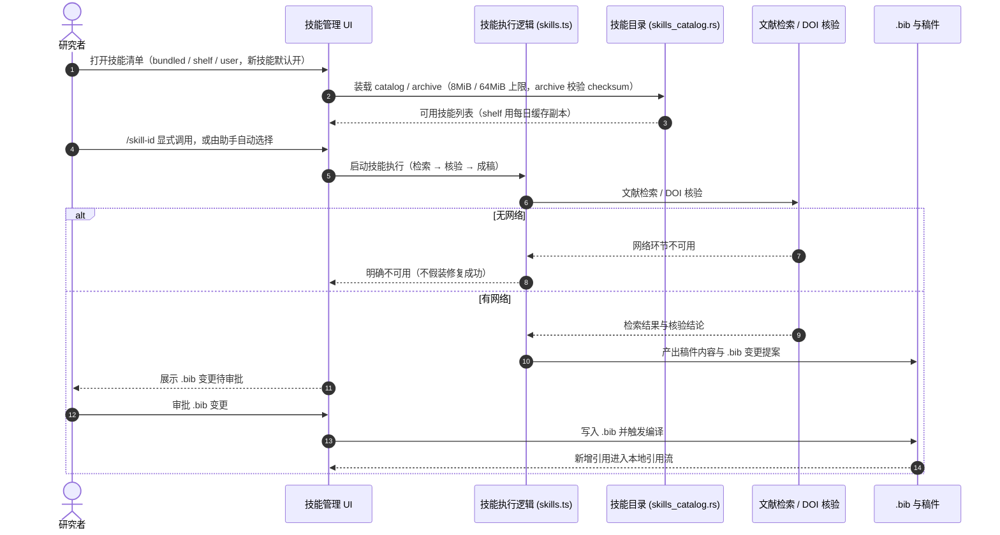

## S22 研究 Skills 调用 场景实现（现状基线）

> module: ai | 场景编号: S22（全局唯一，见 `core-00-scenario-overview.md` 编号注册表） | 优先级: P0
> 基线口径：桌面 0.4.11，绑定提交 `9c307bf3c`（HEAD，领先 `v0.4.11` 标签 3 个提交）
> 本文档为存量产品现状基线：只描述已实现行为，事实来源为提案 `logos/changes/add-baseline-docs/inventory.md` ai 段（S22 行）与 `deltas/prd/1-product-requirements/ai-01-requirements.md` §四 S22 章节。**本次为只读静态盘点，未执行任何测试**，动态行为在 verify 阶段单独取证。
> 路径归属声明：本场景是 ai 模块五条执行路径中 **①内置 Copilot（路径 ①）** 在「技能」维度上的表现，Skills 自身**不构成独立执行路径**，其隔离仍归 turn 快照，不得与 ACP turn copy、Research worktree+manifest、无头 CLI review copy、MCP 无副本混称（需求文档 §1.2）。

### 触发与前置

- **触发条件**：用户需要按既有研究流程检索文献、核验 DOI 并成稿（需求文档 S22 触发条件）。
- **前置条件**：
  - 至少存在一个可用技能，来源为 **bundled / shelf / user** 三类之一；
  - 技能开关状态：**新技能默认开启**；
  - shelf 技能依赖的目录副本：每日缓存；离线时以缓存副本回退；
  - 文献搜索与 DOI 核验环节**需要网络**，离线时这两步明确不可用；
  - catalog 与 archive 有体积与校验约束：catalog 限 8MiB、archive 限 64MiB，archive 带 **checksum 校验**。

### 参与者

| 参与者 | 形态 | 职责 | 证据 |
|---|---|---|---|
| 研究者 | 用户 | 管理技能（bundled/shelf/user）、显式或让助手自动选择技能、审阅并审批 `.bib` 变更 | `docs/Skills.md` L175-205 |
| 技能管理 UI | 前端 | 呈现技能清单与开关状态，暴露 bundled/shelf/user 三类来源 | `src/lib/skills.ts` L65-518 |
| 技能执行逻辑 | 前端（`src/lib/skills.ts`） | 技能装载、选择（`/skill-id` 显式调用或助手自动选择）与步骤执行：检索、核验、成稿 | `src/lib/skills.ts` L65-518 |
| 技能目录 / catalog | Rust（`skills_catalog.rs`） | 管理 catalog 与 archive 的体积上限、checksum 校验及缓存 | `skills_catalog.rs` L17-30 |
| 文献检索 / DOI 核验服务 | 外部网络 | 技能的检索与核验环节；**需要网络**，离线不可用 | `inventory.md` ai 段 S22；`docs/Skills.md` L175-205 |
| 项目 `.bib` 与稿件 | 文件系统 | 技能产出的引用条目与稿件内容的落点 | `inventory.md` ai 段 S22 |

### 主时序

1. **技能管理 UI** — 展示 bundled / shelf / user 三类技能清单及各自开关状态；**新技能默认开启**。
2. **技能目录（Rust）** — 按体积上限（catalog 8MiB / archive 64MiB）装载并对 archive 执行 **checksum 校验**；shelf 目录使用**每日缓存**的副本。
3. **UI** — 研究者以 `/skill-id` **显式调用**技能，或由助手**自动选择**技能。
4. **技能执行逻辑** — 按技能声明的步骤执行：**检索 → 核验 → 成稿**；其中检索与 DOI 核验走外部网络。
5. **外部网络** — 返回检索结果与 DOI 核验结论。
6. **技能执行逻辑** — 产出稿件内容与 `.bib` 变更提案。
7. **UI** — 呈现 `.bib` 变更并请求**审批**。
8. **文件系统** — 审批通过后写入 `.bib`，并**触发编译**；新增引用进入本地引用流。

### 失败与降级分支

逐条对应需求文档 `ai-01-requirements.md` §四 S22 验收条件中的「异常」与「边界」：

| 分支 | 触发条件 | 行为（基线口径） | 证据 |
|---|---|---|---|
| 离线：文献搜索 / DOI 核验 | 技能执行时无网络 | 这些**网络环节明确不可用**；shelf 技能以**每日缓存的目录副本离线回退**，**不假装修复成功** | `inventory.md` ai 段 S22；`docs/Skills.md` L175-205 |
| `.bib` 变更未经审批 | 技能产出 `.bib` 变更但用户未审批 | 变更**不写入**，不触发编译 | 需求文档 §四 S22 正常路径；`src/lib/skills.ts` L65-518 |
| catalog / archive 超限 | 技能目录体积超出上限 | catalog 限 8MiB、archive 限 64MiB；超限不进入装载结果 | `skills_catalog.rs` L17-30 |
| archive checksum 不匹配 | archive 校验未通过 | 校验失败不作为可用技能装载 | `skills_catalog.rs` L17-30 |
| 技能脚本内容不可信 | 技能来自外部来源 | checksum 校验**不替代对技能脚本内容的人工信任**，用户仍须自行审阅脚本后再启用 | `inventory.md` ai 段 S22；`docs/Skills.md` L175-205 |
| 技能默认开关 | 新技能被安装 | **默认开启**——与无头 CLI 默认全 false、Research Task 默认关、MCP 默认关的矩阵**不同** | `inventory.md` ai 段 S22；需求文档 §5.1 |

### 边界与证据

- **技能开关来源**：三类来源为 **bundled（随包内置）/ shelf（货架目录，每日缓存）/ user（用户自备）**；新技能**默认开启**（`src/lib/skills.ts` L65-518；`docs/Skills.md` L175-205）。
- **网络依赖边界**：文献搜索与 DOI 核验**需网络**；离线时这两步明确不可用，shelf 以每日缓存目录副本回退（`inventory.md` ai 段 S22）。
- **信任边界**：catalog 8MiB / archive 64MiB 上限与 checksum 校验**只保证完整性**，**不替代对脚本内容的人工信任**（需求文档 §四 S22 边界）。
- **路径归属边界**：Skills 不是独立执行路径；其落盘变更的隔离归内置 Copilot 的 turn 快照，**不得**与 ACP turn copy、Research worktree+manifest、无头 CLI review copy、MCP 无副本混称（需求文档 §1.2、§5.1）。
- **职责边界**：本场景只覆盖 Skills；内置 Copilot 主体属 S21、无头 CLI 属 S23、模型目录属 S24、ACP 属 S25、Research Task 属 S26、MCP 属 S27、Computer Use 属 S28。
- **实现证据**：
  - `src/lib/skills.ts` L65-518（技能管理、选择与执行）；
  - `docs/Skills.md` L175-205（技能来源、开关、缓存与目录约束）；
  - `skills_catalog.rs` L17-30（catalog / archive 上限与 checksum 校验）。
- **动态验证声明**：本基线为静态盘点，上述行为**未在本次执行任何测试**；真实技能执行、离线回退与 `.bib` 审批链路的断言结果需在 verify 阶段取证，不得预填 PASS。
