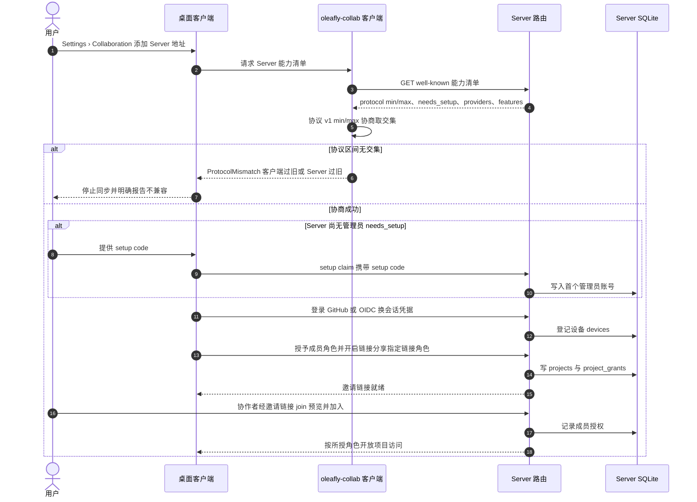

## S29 服务器接入与项目共享 场景实现（现状基线）

> module: collab | 场景编号: S29（全局唯一，见 `core-00-scenario-overview.md` 编号注册表） | 优先级: P0
> 基线口径：桌面 0.4.11，绑定提交 `9c307bf3c`（HEAD，领先 `v0.4.11` 标签 3 个提交）
> 本文档为存量产品现状基线：只描述已实现行为，事实来源为提案 `logos/changes/add-baseline-docs/inventory.md` collab 段（S29 行与该段引言）与 `deltas/prd/1-product-requirements/collab-01-requirements.md` §四 S29 章节。**本次为只读静态盘点，未执行任何测试**，动态行为在 verify 阶段单独取证。
> 本文档不新增功能、不修复文档偏差（偏差 D12 已由 fix-doc-deviations 回补），基线一律以实现为准。

### 一、触发与前置

- **触发条件**：团队要启用实时协作，接入一台自建 Oleafly Collaboration Server（需求文档 S29 触发条件）。
- **前置条件**：
  - 用户已获得自建 Server 地址；Server 已部署并可被访问；
  - Server 若为全新实例（尚无管理员），首个管理员必须持有 setup code 才能完成初始化；
  - 客户端与 Server 的协作协议为 **collab protocol v1**，双方以 min/max 区间协商；区间无交集即视为不兼容；
  - 登录依赖 Server 公布的 provider（GitHub / OIDC 等），provider 与协议能力由 Server 的能力清单（capability manifest）公布；
  - 分享需要项目在本机的完整副本；Server 端项目与成员关系落在 Server 的 SQLite。

### 二、参与者

| 参与者 | 形态 | 职责 | 证据 |
|---|---|---|---|
| 桌面客户端 | Tauri 桌面应用（Settings › Collaboration） | 添加 Server、发起登录与设备登记、分享项目/生成邀请链接并指定角色、显示加入结果 | `docs/collaboration-server.md` L1-28；`src/features/collab/AddServerDialog.tsx`、`ServerCard.tsx`、`ShareDialog.tsx` |
| oleafly-collab | Rust crate（客户端侧） | 读取 Server 能力清单、执行协议 min/max 协商、驱动 OAuth/OIDC 登录与设备身份、持有本地 Server 注册表 | `crates/oleafly-collab/src/client/sign_in.rs`、`diagnostics.rs`、`code_sign_in.rs`、`servers.rs` |
| Server 路由 | Rust crate `oleafly-server`（axum 路由） | 公布能力清单与协议区间、处理 setup claim 与登录回调、登记设备、创建/分享/加入项目 | `crates/oleafly-server/src/routes/meta.rs`、`auth.rs`、`projects.rs`、`devices.rs` |
| SQLite | Server 数据库（migration 0001-0018） | 保存 accounts、devices、projects、project_grants 等准入与授权事实 | `crates/oleafly-server/migrations/0001_core.sql`、`0002_projects.sql`；`inventory.md` 架构要点「数据资产」 |
| 浏览器端 | 浏览器应用 `web/` | **本场景不参与**：加入与分享走桌面端；浏览器侧能力属 S40/S41 | `inventory.md` collab 段 S40/S41 行 |

### 三、主时序

1. **桌面客户端** — 用户在 Settings › Collaboration 选择「Add server」并填入 Server 地址。
2. **oleafly-collab** — 客户端向 Server 请求能力清单（`/.well-known/oleafly-server`），取得 `protocol {min, max}`、`needs_setup`、可用 provider 列表与功能开关。
3. **oleafly-collab** — 客户端用自身的协议区间（protocol v1，min=max=1）与 Server 区间做 **min/max 协商**：取双方区间交集，交集非空则取交集上限作为本次会话的协议版本。
4. **Server 路由 / SQLite** — 若 Server 尚无管理员（`needs_setup`），首个管理员的 setup claim 必须携带 **setup code**；Server 校验 setup code 并把首个账号写入 `accounts`。
5. **桌面客户端 → Server 路由** — 客户端按 Server 公布的 provider 发起登录（GitHub / OIDC）：`/auth/start` → provider 回调 → `/auth/challenge` → `/auth/token`，换回会话凭据；客户端把 Server 条目写入本地 Server 注册表。
6. **Server 路由 / SQLite** — 设备登记：本次登录的设备（device id、公钥等）落入 `devices`，并出现在 `/api/v1/devices` 列表中。
7. **桌面客户端 → Server 路由** — 分享项目：创建/选择项目 → 授予成员角色（`/api/v1/projects/{project}/members`）→ 打开链接分享并指定链接角色（`link_sharing` / `link_role`）。
8. **Server 路由 / SQLite** — 共享事实落库：项目写入 `projects`，成员授权写入 `project_grants`，项目状态含 `link_sharing`、`link_role`、`comments_enabled` 等。
9. **Server 路由** — 协作者经邀请链接访问 `/api/v1/projects/{project}/join`：先预览（`GET`）再加入（`POST`），加入后按所授角色获得项目访问。
10. **桌面客户端** — 加入成功即按所授角色进入共享项目，后续编辑经实时同步通道进行（S30）。

### 四、失败与降级分支

逐条对应需求文档 `collab-01-requirements.md` §四 S29 验收条件中的「异常」与「边界」：

| 分支 | 触发条件 | 行为（基线口径） | 证据 |
|---|---|---|---|
| 协议不兼容 | 客户端与 Server 的协作协议区间无交集 | **停止同步并明确报告**，不产生半同步状态；报错区分「客户端过旧」与「Server 过旧」两个方向 | `inventory.md` collab 段 S29 行；`crates/oleafly-collab-protocol/src/capabilities.rs` |
| 首次 admin 初始化 | 全新 Server 尚无管理员 | 首个管理员初始化**必须提供 setup code**；setup code 校验不通过则不授予管理员身份 | `inventory.md` collab 段 S29 行；`crates/oleafly-server/src/routes/auth.rs` L43-85 |
| 设备被 suspended | 该设备所属账号被 Server 暂停 | 登录/同步被**明确拒绝**（admission suspended → not admitted），不授予访问 | `inventory.md` collab 段 S29 行；`crates/oleafly-server/src/auth/admission.rs` |
| 设备已撤销 | 设备被签出撤销（token 家族被 revoke） | 拒绝该设备的登录/刷新与同步，返回明确错误，不授予访问 | `inventory.md` collab 段 S29 行；`crates/oleafly-server/src/routes/auth.rs` |
| 分享语义（原偏差 D12，已回补） | 旧 README 表述曾致误解 | 重叠文本由 Loro 自动合并 + 只读 Merge Review（S32），并非所有变更都先询问；README 已由 fix-doc-deviations 对齐 | `inventory.md` 偏差 D12；`deltas/prd/1-product-requirements/collab-01-requirements.md` §5.1 |
| 项目内容不是端到端加密 | 用户评估托管风险 | Server 能力清单中 `encryption` 明确为 `None`；宿主、磁盘与备份运营者可读取项目内容，**不得宣传为 E2E 加密** | `inventory.md` collab 段引言；`crates/oleafly-collab-protocol/src/capabilities.rs` |

### 五、边界与证据

- **协议边界**：会话协议版本为 **min/max 协商**的结果，不是固定值；协商失败即停止，不存在「降级到更旧协议」的路径。
- **安全边界**：权限最终由服务端裁决——**服务端逐 change 校验**，客户端 UI 不是安全边界（见 S33）；本场景的客户端步骤只是发起与展示。
- **通道边界**：加入后进入实时同步，桌面端 WS 连续两次失败回退 `/frames`+`/poll` long-poll 并按退避重连（S31）；浏览器端只有 WS 重连、无 long-poll 回退（S40）。
- **加密边界**：项目内容在 Server 侧**不是端到端加密**；每台成员电脑保留项目完整副本，用户需自备磁盘加密（`docs/collaboration-server.md` L1-28）。
- **本场景不做**：Guest 外部协作者（S36）、访问日志与管理控制台（S37）、通知邮件与配额（S38）、服务端备份恢复（S39）、浏览器端协作（S40）与浏览器会话安全（S41）。
- **实现证据**（引自 `inventory.md` collab 段 S29 行）：
  - `docs/collaboration-server.md` L1-28（Server 定位、数据与保密性边界）、L641-765（浏览器访问与共享行为）；
  - `routes/auth.rs` L43-85（登录/设备登记路由与 setup claim）；
  - `e2e/109-live-collaboration-peer.spec.ts` L201-297（真实双端协作 peer 流程）。
- **动态验证声明**：本基线为静态盘点，上述行为**未在本次执行任何测试**；协作 crowd/soak 与浏览器 harness 的动态行为需在 verify 阶段取证，不得预填 PASS。
