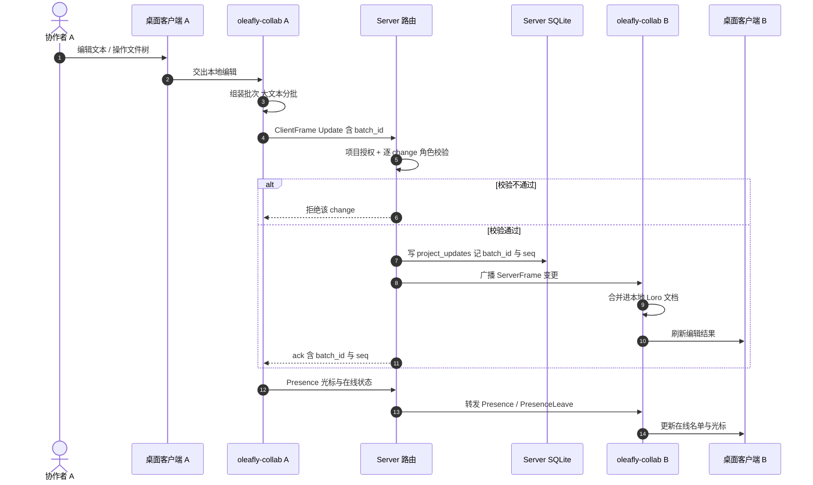

## S30 实时共同编辑 场景实现（现状基线）

> module: collab | 场景编号: S30（全局唯一，见 `core-00-scenario-overview.md` 编号注册表） | 优先级: P0
> 基线口径：桌面 0.4.11，绑定提交 `9c307bf3c`（HEAD，领先 `v0.4.11` 标签 3 个提交）
> 本文档为存量产品现状基线：只描述已实现行为，事实来源为提案 `logos/changes/add-baseline-docs/inventory.md` collab 段（S30 行与该段引言）与 `deltas/prd/1-product-requirements/collab-01-requirements.md` §四 S30 章节。**本次为只读静态盘点，未执行任何测试**，动态行为在 verify 阶段单独取证。
> 本文档不新增功能、不修复文档偏差，基线一律以实现为准。

### 一、触发与前置

- **触发条件**：多个协作者打开同一项目并发编辑（需求文档 S30 触发条件）。
- **前置条件**：
  - 协作者已通过 S29 加入共享项目并具备相应角色（角色边界见 S33）；
  - 已建立实时通道：桌面端优先 WebSocket，失败时按 S31 的规则回退 `/frames`+`/poll`；
  - 会话协议版本已按 collab protocol v1 的 min/max 协商确定；
  - 传输层具备分批发送大文本能力，并有静默超时（quiet timeout）保护：默认 `ping_every = 20s`、`quiet_for = 30s`；
  - 项目内容在 Server 侧**不是端到端加密**（capability 明确 `encryption=None`）。

### 二、参与者

| 参与者 | 形态 | 职责 | 证据 |
|---|---|---|---|
| 桌面客户端 | Tauri 桌面应用（编辑器 / 文件树） | 承载文本编辑、文件树操作、光标与在线状态展示；把本地编辑打包成批发送 | `crates/oleafly-collab/src/sync/online.rs`、`crates/oleafly-collab/src/sync/mod.rs`；`src/features/collab/sharing/TreePresence.tsx` |
| oleafly-collab | Rust crate（同步引擎 + 协议） | 生成/消费变更帧、分批发送文本、presence 帧编解码、损坏帧隔离、Loro 文档收敛 | `crates/oleafly-collab/src/sync/`；`crates/oleafly-collab-protocol/src/frames.rs` |
| Server 路由 | Rust crate `oleafly-server`（`/ws`、`/frames`、`/poll`） | 接收帧、逐帧做角色校验、按 seq 持久化并广播给同项目其他 peer | `crates/oleafly-server/src/routes/ws.rs`、`poll.rs` |
| SQLite | Server 数据库（migration 0001-0018） | 持久化 `project_updates`（含 `batch_id`、`seq`）与 `project_snapshots` | `crates/oleafly-server/migrations/0002_projects.sql`；`inventory.md` 架构要点「数据资产」 |
| 浏览器端 | 浏览器应用 `web/` | **本场景桌面主路径不参与**：浏览器端的同能力与差异见 S40（只有 WS 重连、无 long-poll 回退） | `inventory.md` collab 段 S40 行 |

### 三、主时序

1. **桌面客户端** — 协作者 A 在项目中编辑文本 / 操作文件树；客户端把编辑转换为协议变更（文本操作、节点操作）。
2. **oleafly-collab** — 同步引擎把待发变更组装为**批次（batch）**，大文本按分批发送；每批带 `batch_id`。
3. **oleafly-collab → Server 路由** — 客户端经 WebSocket（失败则 `/frames` + `/poll`）发送 `ClientFrame::Update`，帧体带 `project_id` 与签名后的 envelope。
4. **Server 路由** — 逐帧校验：项目授权 + **逐 change 的角色校验**（见 S33；服务端裁决，客户端 UI 不是安全边界）。
5. **Server 路由 / SQLite** — 校验通过后写入 `project_updates`（记录 `batch_id` 与递增 `seq`），并向同项目其他 peer 广播。
6. **Server 路由 → oleafly-collab（其他端）** — 其他协作者端收到 `ServerFrame` 中的变更与 `ack`（含 `batch_id`、`seq`）。
7. **oleafly-collab** — 接收端把变更合并进本地 Loro 文档，各端内容收敛一致。
8. **oleafly-collab / 桌面客户端** — presence 帧（`Presence` / `PresenceLeave`）同步光标位置与在线状态，各端显示其他协作者的位置与在线名单。
9. **桌面客户端** — 发送端收到 `ack` 后清除该批待发内容（`ack` 丢失场景由 S31 的补发与幂等兜底）。

### 四、失败与降级分支

逐条对应需求文档 `collab-01-requirements.md` §四 S30 验收条件中的「异常」与「边界」：

| 分支 | 触发条件 | 行为（基线口径） | 证据 |
|---|---|---|---|
| 单批过大 | 某单批数据过大被判定为 **Unsendable** | 该批**暂不发送**，发出 `Unsendable` 事件提示用户；**不阻断其他内容的同步** | `inventory.md` collab 段 S30 行；`crates/oleafly-collab/src/sync/online.rs`；`crates/oleafly-collab/src/sync/tests/big_files.rs` L6-317 |
| 大文本分批 | 单个文件文本体积大 | 文本按**分批**发送，最终仍完整收敛 | `crates/oleafly-collab/src/sync/tests/big_files.rs` L6-317 |
| 慢上传被误判 | 客户端上传缓慢 | 慢上传**不被 quiet timeout 误判**为掉线；静默超时按 `quiet_for`（默认 30s）与 `ping_every`（默认 20s）判定，并有上传时限补偿 | `inventory.md` collab 段 S30 行；`crates/oleafly-collab/src/sync/mod.rs` L191-207；`crates/oleafly-collab/src/client/mod.rs` |
| 损坏 frame | 个别 frame 解析失败 | **损坏 frame 不阻断后续 frame 的处理**，其余帧继续按序处理 | `inventory.md` collab 段 S30 行；`crates/oleafly-collab/src/sync/tests/transport.rs` L297-366 |
| 传输通道不可用 | WebSocket 连续失败 | 桌面端按 S31 规则回退 `/frames`+`/poll` long-poll（**浏览器端无此回退**，见 S40） | `inventory.md` collab 段 S31/S40 行 |
| 越权变更 | 客户端发出超出角色权限的 change | 服务端逐 change 校验并**拒绝**，不依赖客户端 UI 自我约束（详见 S33） | `inventory.md` collab 段 S33 行；`crates/oleafly-server/src/routes/ws.rs` |
| 项目内容保密性 | 用户以为 Server 侧内容加密 | Server capability 明确 `encryption=None`；**项目内容不是端到端加密**，宿主/磁盘/备份运营者可读 | `inventory.md` collab 段引言；`crates/oleafly-collab-protocol/src/capabilities.rs` |

### 五、边界与证据

- **收敛边界**：文本重叠编辑由 Loro 自动合并（S32），本场景只保证「实时收敛」，不承诺「所有重叠都要人工二选一」。
- **权限边界**：本场景的实时性不改变授权模型——服务端逐 change 校验是唯一裁决点。
- **持久化边界**：Server 侧变更落 `project_updates`，快照落 `project_snapshots`；客户端重启后的补发与幂等由 S31 承接。
- **保密性边界**：**项目内容不是端到端加密**；每台成员电脑保留完整副本，需自备磁盘加密（`docs/collaboration-server.md` L1-28）。
- **本场景不做**：断线重连与增量补发（S31）、离线冲突合并与审查（S32）、角色权限边界（S33）、评论建议与聊天（S34）、共享历史与版本恢复（S35）。
- **实现证据**（引自 `inventory.md` collab 段 S30 行）：
  - `collab/sync/tests/editing.rs` L3-59（并发编辑收敛）；
  - `collab/sync/tests/big_files.rs` L6-317（大文本分批与 Unsendable 不阻断）；
  - `collab/sync/tests/transport.rs` L297-366（损坏 frame 不阻断后续）。
- **动态验证声明**：本基线为静态盘点，上述行为**未在本次执行任何测试**；协作 crowd/soak 动态行为需在 verify 阶段取证，不得预填 PASS。
