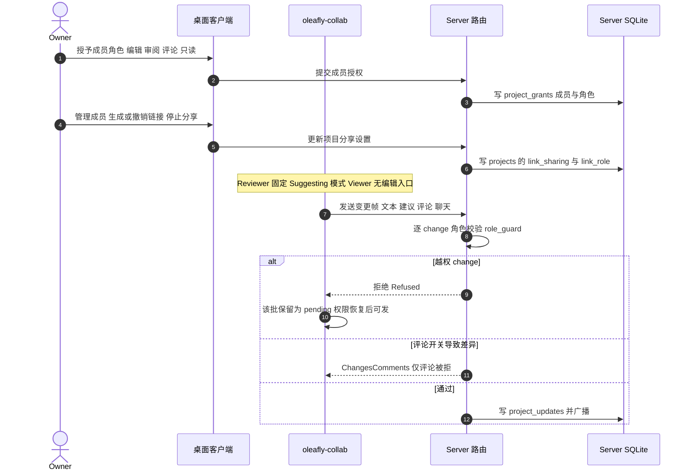

## S33 协作角色权限边界 场景实现（现状基线）

> module: collab | 场景编号: S33（全局唯一，见 `core-00-scenario-overview.md` 编号注册表） | 优先级: P0
> 基线口径：桌面 0.4.11，绑定提交 `9c307bf3c`（HEAD，领先 `v0.4.11` 标签 3 个提交）
> 本文档为存量产品现状基线：只描述已实现行为，事实来源为提案 `logos/changes/add-baseline-docs/inventory.md` collab 段（S33 行与该段引言）与 `deltas/prd/1-product-requirements/collab-01-requirements.md` §四 S33 章节。**本次为只读静态盘点，未执行任何测试**，动态行为在 verify 阶段单独取证。
> 本文档不新增功能、不修复文档偏差，基线一律以实现为准。

### 一、触发与前置

- **触发条件**：项目内存在 Owner / Editor / Reviewer / Commenter / Viewer 多角色协作（需求文档 S33 触发条件）。
- **前置条件**：
  - 项目已共享，成员在 `project_grants` 中持有五角色之一（`ProjectRole::{Owner, Editor, Reviewer, Commenter, Viewer}`）；
  - 可授予的角色为 Editor / Reviewer / Commenter / Viewer（`GRANTABLE_ROLES`），Owner 由项目归属决定；
  - **Reviewer 固定处于 Suggesting 模式**（不能切回直接编辑）；
  - 权限裁决点在服务端：**服务端逐 change 校验**，客户端 UI 的隐藏/禁用**不是安全边界**；
  - 项目内容在 Server 侧**不是端到端加密**（capability 明确 `encryption=None`）。

### 二、参与者

| 参与者 | 形态 | 职责 | 证据 |
|---|---|---|---|
| 桌面客户端 | Tauri 桌面应用 | 按角色呈现可用操作（编辑/建议/评论/分享）、Owner 管理成员与链接、停止分享 | `src/features/collab/roles.ts`、`ProjectRolePicker.tsx`、`ManageSharing.tsx`；`crates/oleafly-collab-protocol/src/roles.rs` |
| oleafly-collab | Rust crate（角色模型 + 客户端行为） | 定义五角色枚举与可授予集合、在本地按角色约束编辑器行为（Reviewer 固定 Suggesting） | `crates/oleafly-collab-protocol/src/roles.rs` L16-35；`crates/oleafly-collab-protocol/src/projects.rs` L108-143 |
| Server 路由 | Rust crate `oleafly-server` | **逐 change 校验角色**（`role_guard`），拒绝越权 change、裁决 comments 开关导致的评论变更 | `crates/oleafly-server/src/role_guard.rs`；`crates/oleafly-server/src/routes/ws.rs` L1057-1071 |
| SQLite | Server 数据库（migration 0001-0018） | `project_grants` 保存成员与角色；`projects` 保存 `link_sharing` / `link_role` 等分享设置 | `crates/oleafly-server/migrations/0002_projects.sql`、`0015_review_roles.sql` |
| 浏览器端 | 浏览器应用 `web/` | 按角色映射前端能力（`abilitiesFor` / `effectiveMode`），但**仅是 UI 呈现，裁决仍在服务端** | `web/src/roles.ts` L14-38；`inventory.md` collab 段 S40 行 |

### 三、主时序

1. **桌面客户端** — Owner 打开成员管理，授予成员五角色之一（Editor / Reviewer / Commenter / Viewer）；Owner 自身持有 Owner 角色。
2. **Server 路由 / SQLite** — 授权写入 `project_grants`（成员 + 角色）；项目级分享设置（`link_sharing` / `link_role`）写入 `projects`。
3. **桌面客户端** — Owner 可管理成员、生成/撤销邀请链接、开启或停止分享（停止分享后项目转入只读保留，见 S39/S37 口径）。
4. **oleafly-collab** — 客户端按角色约束本地交互：**Reviewer 固定 Suggesting 模式**；Viewer 无编辑入口；Commenter 只能评论/聊天。
5. **oleafly-collab → Server 路由** — 各端把编辑/建议/评论/聊天作为变更帧发送。
6. **Server 路由** — **逐 change** 判定角色：越权的文本/建议/评论/清空他人内容被**拒绝**（`RoleVerdict::Refused`）；评论开关导致的差异判为 `ChangesComments`。
7. **Server 路由 / SQLite** — 通过校验的变更写入 `project_updates` 并广播。
8. **桌面客户端** — 被拒绝的一侧收到明确拒绝结果：文本编辑被拒时本批变更保留为 **pending**（不丢弃），权限恢复后可再发出。

### 四、失败与降级分支

逐条对应需求文档 `collab-01-requirements.md` §四 S33 验收条件中的「异常」与「边界」：

| 分支 | 触发条件 | 行为（基线口径） | 证据 |
|---|---|---|---|
| 越权 change | 客户端发出超出角色权限的 change | **服务端逐 change 校验并拒绝**，不依赖客户端 UI 的自我约束——客户端 UI **不是安全边界** | `inventory.md` collab 段 S33 行；`crates/oleafly-server/src/role_guard.rs`；`crates/oleafly-server/src/routes/ws.rs` L1057-1071 |
| Reviewer 固定 Suggesting | Reviewer 尝试直接编辑 | Reviewer 处于固定 Suggesting 模式；其编辑以建议形式提交，不直接改写正文 | `inventory.md` collab 段 S33 行；`crates/oleafly-collab-protocol/src/roles.rs`；`web/src/roles.ts` L14-38 |
| 被移出项目 | 用户被移除成员授权 | **同步结束**（不再获得项目访问），不产生半同步状态 | `inventory.md` collab 段 S33 行；`crates/oleafly-server/src/routes/projects.rs`（成员移除路由） |
| 项目被归档 | 项目进入 Archived 状态 | **同步结束**；归档后项目在 Server 侧保留只读一段时间后删除 | `inventory.md` collab 段 S33 行、`docs/collaboration-server.md` L1-28 |
| Viewer 期间的本地编辑 | Viewer 在受限期间做了本地编辑 | 本地编辑**保留为 pending**，权限恢复后可发出；Viewer's forbidden 拒绝会丢弃该批但保留每条 change 与本地内容 | `inventory.md` collab 段 S33 行；`crates/oleafly-collab/src/sync/tests/refusals.rs` L17-118 |
| Commenter 越界 | Commenter 尝试改文本/改建议/清空他人内容 | **拒绝**；Commenter 仅可评论与聊天 | `inventory.md` collab 段 S33/S34 行；`crates/oleafly-server/src/role_guard.rs` |
| Owner 停止分享 | Owner 停止分享项目 | 项目转入只读保留；Owner 可撤销链接与成员授权 | `inventory.md` collab 段 S33 行；`docs/collaboration-server.md` L1-28 |
| 保密性边界 | 用户评估托管风险 | Server capability `encryption=None`，**项目内容不是端到端加密**；宿主/磁盘/备份运营者可读 | `inventory.md` collab 段引言 |

### 五、边界与证据

- **安全边界（本场景核心）**：权限裁决**只在服务端逐 change 执行**；客户端的角色化 UI、隐藏按钮与本地禁用一律不构成安全边界。绕过客户端直接构造帧同样会被拒绝。
- **角色集合边界**：五角色为 Owner / Editor / Reviewer / Commenter / Viewer；可授予的是 Editor / Reviewer / Commenter / Viewer 四个。
- **模式边界**：Reviewer 固定 Suggesting；Owner 的分享管理能力不等于内容授权（Admin 的项目管理也不等于项目内容授权，见 S37）。
- **协议与通道边界**：会话按 **collab protocol v1 的 min/max 协商**确定，不兼容即停止同步（S29）；桌面端 WS 失败两次后回退 long-poll 并按退避重连（S31），浏览器端只有 WS 重连、无 long-poll 回退（S40）。
- **拒绝与保留的区分**：Viewer's forbidden 拒绝会**丢弃该批**（但保留每条 change 与本地内容，后续可再发）；comments off 拒绝**只摘掉评论**、文本继续（见 S34）。二者语义不同，不得混称。
- **本场景不做**：评论/建议/聊天的完整语义（S34）、Guest 角色（S36）、访问日志与 Admin 控制台（S37）、浏览器端角色呈现（S40）。
- **实现证据**（引自 `inventory.md` collab 段 S33 行）：
  - `collab-protocol/projects.rs` L108-143（项目与成员/角色/presence 结构）；
  - `server/tests/review_roles.rs` L148-409（五角色在服务端的行为）；
  - `collab/sync/tests/refusals.rs` L17-118（越权拒绝、Viewer pending 语义）；
  - `e2e/109-live-collaboration-peer.spec.ts` L331-350（真实双端的角色边界）。
- **动态验证声明**：本基线为静态盘点，上述行为**未在本次执行任何测试**；需在 verify 阶段取证，不得预填 PASS。
