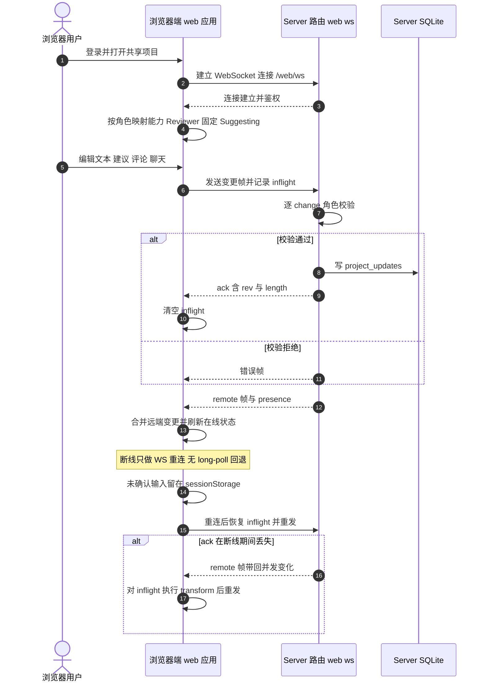

## S40 浏览器实时协作 场景实现（现状基线）

> module: collab | 场景编号: S40（全局唯一，见 `core-00-scenario-overview.md` 编号注册表） | 优先级: P0
> 基线口径：桌面 0.4.11，绑定提交 `9c307bf3c`（HEAD，领先 `v0.4.11` 标签 3 个提交）
> 本文档为存量产品现状基线：只描述已实现行为，事实来源为提案 `logos/changes/add-baseline-docs/inventory.md` collab 段（S40 行与该段引言）与 `deltas/prd/1-product-requirements/collab-01-requirements.md` §四 S40 章节。**本次为只读静态盘点，未执行任何测试**，动态行为在 verify 阶段单独取证。
> 本文档不新增功能、不修复文档偏差，基线一律以实现为准。

### 一、触发与前置

- **触发条件**：协作者无桌面端，经浏览器访问 Server 参与协作（需求文档 S40 触发条件）。
- **前置条件**：
  - Server 开启浏览器访问能力（`features.web`），浏览器端有可用会话（会话细节见 S41）；
  - 协作者已登录并对项目具备相应角色（角色映射见 S33，浏览器端映射见本文件「参与者」行）；
  - 浏览器端传输**只有 WebSocket**：连接地址为 `/web/ws`；**没有桌面端的 `/frames`+`/poll` long-poll 回退**；
  - 浏览器端**没有离线编辑能力**：离线时的新编辑被拒；
  - `sessionStorage` 中的未确认输入有上限：约 2M 字符 / 7 天；**不是跨设备离线队列**；
  - 项目内容在 Server 侧**不是端到端加密**（capability 明确 `encryption=None`）。

### 二、参与者

| 参与者 | 形态 | 职责 | 证据 |
|---|---|---|---|
| 桌面客户端 | Tauri 桌面应用 | **本场景不参与主路径**：浏览器协作的对照面是桌面端（桌面端有 WS→long-poll 回退与离线编辑，浏览器端两者皆无） | `inventory.md` collab 段 S30/S31 行 |
| oleafly-collab | Rust crate（Server 侧文档服务） | 服务端持有 Loro 文档与房间、按角色裁决浏览器发来的变更、产出 ack/remote 帧 | `crates/oleafly-server/src/web/room.rs`、`crates/oleafly-server/src/web/gateway.rs`；协议帧定义见 `crates/oleafly-collab-protocol/src/frames.rs` |
| Server 路由 | Rust crate `oleafly-server`（`/web/ws` 升级 + `/web/api/*`） | 浏览器 WS 升级与鉴权、文本/输出读取 API、逐 change 角色校验 | `crates/oleafly-server/src/web/mod.rs` L30-50；`crates/oleafly-server/src/web/api.rs`；`crates/oleafly-server/src/web/gateway.rs` |
| SQLite | Server 数据库（migration 0001-0018） | 保存 `project_updates`（change log）、`project_snapshots`、`web_sessions`（浏览器会话）、`project_outputs` | `crates/oleafly-server/migrations/0002_projects.sql`、`0017_project_outputs.sql`、`0018_web_sessions.sql` |
| 浏览器端 | 浏览器应用 `web/`（`web/src/gateway.ts`、`roles.ts`、`unsent.ts`、`controller.ts`） | 建立/维护 WebSocket、按角色映射能力、发起编辑/建议/评论/聊天、展示 presence、离线时拒绝新编辑并保留未确认输入 | `web/src/gateway.ts` L73-98、L280-649；`web/src/roles.ts` L14-38；`web/src/unsent.ts` L12-75；`web/src/gateway.test.ts` L316-462 |

### 三、主时序

1. **浏览器端** — 用户在浏览器登录 Server（会话建立见 S41），打开共享项目。
2. **浏览器端 → Server 路由** — 浏览器经 `/web/ws` 建立 WebSocket 连接；连接携带浏览器会话，Server 完成升级与鉴权。
3. **浏览器端** — 前端按角色映射能力（`abilitiesFor`）：Owner/Editor 可编辑并可切换模式，Reviewer 固定 Suggesting，Commenter 仅评论与聊天，Viewer 只读；`effectiveMode` 强制 Reviewer 为 suggesting。
4. **浏览器端 → Server 路由** — 用户编辑文本：浏览器端把变更作为 WebSocket 帧发送，并记录 **inflight**（未确认的变更）。
5. **Server 路由** — 逐 change 校验角色与项目状态；通过后写入 `project_updates` 并回 `ack`（含 rev/length）。
6. **浏览器端** — 收到 `ack` 后清空 inflight；其他端收到 `remote` 帧并把内容合并到本地编辑器，presence 同步在线状态与光标。
7. **浏览器端** — 断线时：客户端按 `reconnectDelay`（指数退避 + 抖动，基准 500ms、上限 15s）做 **WS 重连**；失败累计到 `PROBE_AFTER_FAILURES = 2` 时触发探测。
8. **浏览器端** — 重连期间，**未确认的输入保留在 `sessionStorage`**（约 2M 字符 / 7 天上限）；重连成功后恢复 inflight 通道与这些未确认输入。
9. **浏览器端 / Server 路由** — 若 ack 在断线期间丢失：服务端以 `remote` 帧带回并发变化，浏览器端对 inflight 操作执行 **transform**（`TextOperation.transform`）后重发；若 transform 失败则丢弃 inflight 并重新打开该文件。

### 四、失败与降级分支

逐条对应需求文档 `collab-01-requirements.md` §四 S40 验收条件中的「异常」与「边界」：

| 分支 | 触发条件 | 行为（基线口径） | 证据 |
|---|---|---|---|
| WS 断线 | 浏览器端 WebSocket 断线 | **只有 WS 重连，没有桌面端的 `/frames`+`/poll` long-poll 回退**；重连按指数退避 + 抖动（500ms 基准、15s 上限） | `inventory.md` collab 段 S40 行；`web/src/gateway.ts` L73-98、L280-649 |
| 离线新编辑 | 浏览器处于离线状态 | 新编辑**被拒绝**（`OfflineError`）——浏览器端没有离线编辑能力；文档通道未打开、正在恢复或不在线时同样拒绝 | `inventory.md` collab 段 S40 行；`web/src/gateway.ts`（`changeDoc`） |
| sessionStorage 上限 | 未确认输入积压 | 上限约 **2M 字符 / 7 天**；这是**本标签页的未确认输入缓冲，不是跨设备离线队列** | `inventory.md` collab 段 S40 行；`web/src/unsent.ts` L12-75 |
| ack 丢失 | 断线期间服务端已接受变更但 ack 未送达 | 服务端以 `remote` 帧带回并发变化，浏览器端对 inflight 操作执行 **transform** 后重发；transform 失败则丢弃 inflight 并重新打开该文件 | `inventory.md` collab 段 S40 行；`web/src/gateway.ts`（`routeDoc`） |
| 单次变更过大 | 变更帧超过浏览器端单次上限 | 判为过大并提示，丢弃 inflight 后重新打开该文件（不静默失败） | `web/src/gateway.ts`（`tooLarge`） |
| 会话失效 | 浏览器会话过期或权限终止 | 结束访问，错误码如 `unauthorized` / `forbidden` / `not_found` / `removed` / `archived`（见 S41） | `web/src/gateway.ts`（`SIGNED_OUT_CODES` / `NO_ACCESS_CODES`） |
| 越权操作 | 浏览器端构造超出角色的请求 | 服务端逐 change 校验并拒绝（见 S33）；浏览器端角色映射只是 UI 呈现 | `inventory.md` collab 段 S33/S40 行 |
| 保密性边界 | 用户评估托管风险 | Server 侧 `encryption=None`，**项目内容不是端到端加密** | `inventory.md` collab 段引言 |

### 五、边界与证据

- **能力差异边界（本场景核心）**：浏览器端与桌面端**不可混称**——浏览器端**无 long-poll 回退**、**无离线编辑**；`sessionStorage` 缓冲**不是跨设备离线队列**。
- **生产与测试边界**：浏览器 E2E 使用 fake engine，**不等同生产**；生产浏览器**没有编译引擎**，浏览器只查看 Owner/Editor 上传的输出（S42）。
- **安全边界**：浏览器端角色映射（`abilitiesFor` / `effectiveMode`）只决定 UI 呈现；**裁决在服务端逐 change 校验**（S33）。
- **会话边界**：会话 cookie、Origin 与 app marker 校验、严格 CSP 属 S41，本文件不重复展开。
- **协议边界**：会话按 **collab protocol v1 的 min/max 协商**确定，不兼容即停止同步（S29）；浏览器端同样**没有 long-poll 回退**，只有 WS 重连。
- **本场景不做**：浏览器会话安全（S41）、浏览器输出查看（S42）、桌面端回退与离线编辑（S31）。
- **实现证据**（引自 `inventory.md` collab 段 S40 行）：
  - `web/mod.rs` L30-50（浏览器路由：`/web/ws` 与 `/web/api/*`）；
  - `web/src/roles.ts` L14-38（角色能力映射与 Reviewer 固定 suggesting）；
  - `web/src/gateway.ts` L73-98、L280-649（WS 重连退避、inflight/ack/remote/transform）；
  - `web/src/unsent.ts` L12-75（sessionStorage 未确认输入与上限）；
  - `web/src/gateway.test.ts` L316-462（浏览器网关行为测试）。
- **动态验证声明**：本基线为静态盘点，上述行为**未在本次执行任何测试**；浏览器 harness 的动态行为需在 verify 阶段取证，不得预填 PASS。
