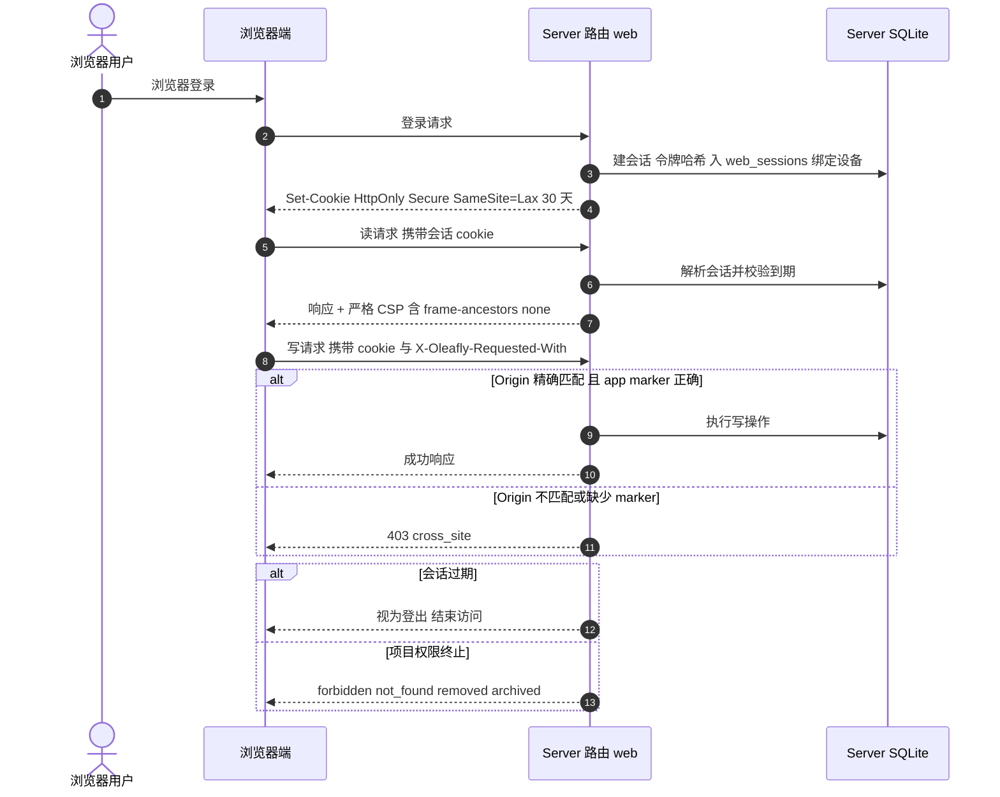

## S41 浏览器会话安全 场景实现（现状基线）

> module: collab | 场景编号: S41（全局唯一，见 `core-00-scenario-overview.md` 编号注册表） | 优先级: P0
> 基线口径：桌面 0.4.11，绑定提交 `9c307bf3c`（HEAD，领先 `v0.4.11` 标签 3 个提交）
> 本文档为存量产品现状基线：只描述已实现行为，事实来源为提案 `logos/changes/add-baseline-docs/inventory.md` collab 段（S41 行与该段引言）与 `deltas/prd/1-product-requirements/collab-01-requirements.md` §四 S41 章节。**本次为只读静态盘点，未执行任何测试**，动态行为在 verify 阶段单独取证。
> 本文档不新增功能、不修复文档偏差，基线一律以实现为准。

### 一、触发与前置

- **触发条件**：浏览器客户端访问 Server 的所有会话（需求文档 S41 触发条件）。
- **前置条件**：
  - Server 开启浏览器访问能力（`features.web` / 配置 `web`）；
  - 浏览器会话通过 `web_sessions` 管理，会话期限 **30 天**（`SESSION_DAYS = 30`）；
  - 会话 cookie 属性为 **HttpOnly / Secure / SameSite=Lax**；服务端以哈希存储会话令牌；
  - 写请求需同时满足**精确 Origin 匹配**与 **`X-Oleafly-Requested-With` app marker**（值为 `oleafly-web`）；
  - 页面响应带**严格 CSP**，其中 `frame-ancestors 'none'` 禁止被嵌入；
  - 项目内容在 Server 侧**不是端到端加密**（capability 明确 `encryption=None`）。

### 二、参与者

| 参与者 | 形态 | 职责 | 证据 |
|---|---|---|---|
| 桌面客户端 | Tauri 桌面应用 | **本场景不参与**：会话安全只针对浏览器访问路径；桌面端走设备凭据与 `/api/v1/*` 路由 | `inventory.md` collab 段 S29 行（桌面端登录与设备登记） |
| oleafly-collab | Rust crate（Server 侧） | 提供会话身份解析（`web_sessions::resolve`）与设备绑定，供路由层判定调用者 | `crates/oleafly-server/src/web_sessions.rs`；`crates/oleafly-collab-protocol/src/crypto.rs` |
| Server 路由 | Rust crate `oleafly-server`（`/web/*` 与 `/web/api/*`） | 建立/清除会话 cookie、校验 Origin 与 app marker、返回明确错误码、下发严格 CSP | `crates/oleafly-server/src/web/mod.rs` L145-188；`crates/oleafly-server/src/web/api.rs` L197-244、L454-542；`crates/oleafly-server/src/web/assets.rs` |
| SQLite | Server 数据库（migration 0001-0018） | `web_sessions` 保存浏览器会话（令牌哈希、到期、绑定设备）；`devices` 记录浏览器登录设备 | `crates/oleafly-server/migrations/0018_web_sessions.sql`、`0001_core.sql` |
| 浏览器端 | 浏览器应用 `web/`（`web/src/session.ts`、`api.ts`、`gateway.ts`） | 携带会话 cookie 发起请求、按服务端状态处理会话结束、WS 升级携带会话 | `web/src/session.ts`；`web/src/api.ts`；`web/src/gateway.ts` |

### 三、主时序

1. **浏览器端 → Server 路由** — 用户在浏览器完成登录（`/web/sign-in` 与 `/auth/start` 的 web 流程），Server 建立浏览器会话。
2. **Server 路由 / SQLite** — Server 生成会话令牌（随机、哈希后入库），在 `web_sessions` 写入会话（到期时间 = 建立时间 + 30 天），并绑定浏览器设备。
3. **Server 路由 → 浏览器端** — 响应下发会话 cookie：**HttpOnly**（脚本不可读）、**SameSite=Lax**、**Secure**（本机明文 HTTP 场景除外），作用域限定 `/web/`。
4. **浏览器端 → Server 路由** — 读请求携带会话 cookie；Server 解析 cookie（只认期望的 cookie 名与合法格式，旁带的同名 cookie 不被信任），解析会话并校验到期。
5. **浏览器端 → Server 路由** — **写请求**额外携带 `X-Oleafly-Requested-With: oleafly-web`，且 `Origin` 必须**精确等于** Server 公开地址的 origin。
6. **Server 路由** — 写请求校验：`Origin` 不匹配或 app marker 缺失 → 判定为 **cross_site** 并拒绝（403）。
7. **Server 路由 → 浏览器端** — 页面响应下发**严格 CSP**（`default-src 'self'` 等，并含 `frame-ancestors 'none'`），禁止被 framing。
8. **Server 路由** — 项目级与容量级失败返回明确错误码：`forbidden` / `not_found` / `removed` / `archived` / `project_too_large` / `server_busy`。

### 四、失败与降级分支

逐条对应需求文档 `collab-01-requirements.md` §四 S41 验收条件中的「异常」与「边界」：

| 分支 | 触发条件 | 行为（基线口径） | 证据 |
|---|---|---|---|
| 会话过期 | 浏览器会话超过 30 天期限 | **过期会话视为登出**，结束当前访问 | `inventory.md` collab 段 S41 行；`crates/oleafly-server/src/web_sessions.rs`（`SESSION_DAYS = 30`） |
| 访问终止 | 服务端判定 `forbidden` / `not_found` / `removed` / `archived` | 对应错误**结束当前访问**，浏览器端按错误码结束会话 | `inventory.md` collab 段 S41 行；`crates/oleafly-server/src/web/mod.rs` L145-188；`web/src/gateway.ts`（`NO_ACCESS_CODES`） |
| Origin 错误 | 写请求来自错误 Origin | 判为 **cross_site** 并拒绝（403），消息明示「该请求并非来自本 Server 上的 Oleafly 网页应用」 | `inventory.md` collab 段 S41 行；`crates/oleafly-server/src/web/mod.rs`（`same_origin` / `requested_by_the_app` / `cross_site`） |
| 缺少 app marker | 写请求未带 `X-Oleafly-Requested-With` | 同样判为 **cross_site** 并拒绝 | `inventory.md` collab 段 S41 行；`crates/oleafly-server/src/web/mod.rs` |
| 项目过大 | 请求体/项目超过上限 | 返回 **`project_too_large`**（冲突状态码） | `inventory.md` collab 段 S41 行；`crates/oleafly-server/src/web/api.rs` L197-244 |
| 服务繁忙 | Server 过载 | 返回 **`server_busy`**（服务不可用状态码） | `inventory.md` collab 段 S41 行；`crates/oleafly-server/src/web/api.rs` L454-542 |
| 被 framing | 第三方站点尝试嵌入 | 严格 CSP 含 `frame-ancestors 'none'`，**禁止被嵌入** | `inventory.md` collab 段 S41 行；`crates/oleafly-server/src/web/assets.rs` |
| 令牌旁带伪造 | 客户端在真实 cookie 旁附带同名的伪造 cookie | 只读取**期望名**且格式合法的 cookie，伪造项不被信任 | `crates/oleafly-server/src/web_sessions.rs`（`presented`） |
| 保密性边界 | 用户评估托管风险 | Server 侧 `encryption=None`，**项目内容不是端到端加密**；会话令牌在服务端以哈希存储，不存明文 | `inventory.md` collab 段引言；`docs/collaboration-server.md` L1-28 |

### 五、边界与证据

- **会话边界**：浏览器会话 **30 天**到期后视为登出；会话令牌**只以哈希入库**，服务端不保存明文令牌。
- **写请求边界**：写请求的双重校验（**精确 Origin** + **app marker**）是**服务端**判定；浏览器端带头不构成安全保证——请求可由任意客户端伪造，因此判定必须落在服务端。
- **页面边界**：严格 CSP 禁止 framing；CSP 与 cookie 属性是**两个独立防护**，不可互相替代。
- **范围边界**：本场景只覆盖**浏览器会话**；桌面端凭据、Guest admission、Admin 控制台分属 S29/S36/S37。
- **权限边界**：会话有效不等于有权改动内容——写操作仍受**服务端逐 change 的角色校验**约束（S33），客户端 UI 不是安全边界。
- **协议与通道边界**：会话按 **collab protocol v1 的 min/max 协商**确定，不兼容即停止同步（S29）；**浏览器端只有 WS 重连、无 long-poll 回退**（S40），桌面端才有 WS 失败两次后的 long-poll 回退（S31）。
- **本场景不做**：浏览器协作功能本身（S40）、浏览器输出查看（S42）、桌面端登录与设备登记（S29）。
- **实现证据**（引自 `inventory.md` collab 段 S41 行）：
  - `docs/collaboration-server.md` L921-931（浏览器访问的会话与保密性口径）；
  - `web/mod.rs` L145-188（会话解析、Origin/app marker 校验、cross_site 拒绝）；
  - `web_api.rs` L197-244、L454-542（`project_too_large` / `server_busy` 等错误映射与 API 处理）。
- **动态验证声明**：本基线为静态盘点，上述行为**未在本次执行任何测试**；浏览器 harness 与 Server 集成测试需在 verify 阶段取证，不得预填 PASS。
