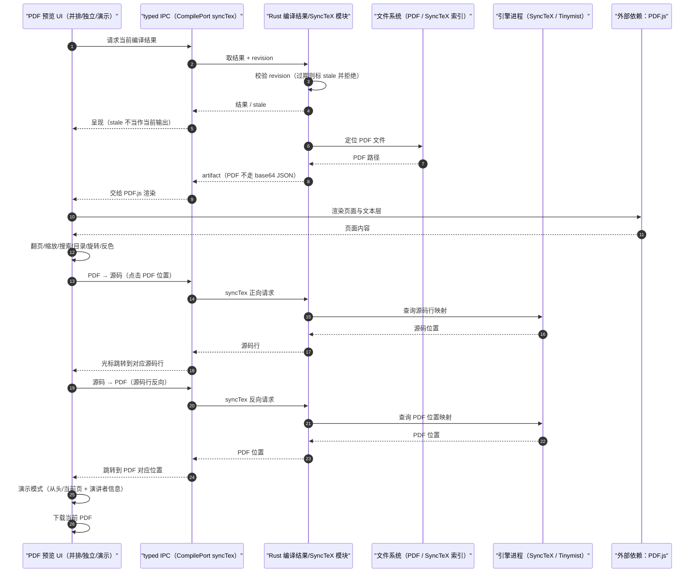

## S09 PDF 预览与源文核对演示 场景实现（现状基线）

> **基线口径**：桌面 0.4.11，绑定提交 `9c307bf3c`（HEAD，领先 `v0.4.11` 标签 3 个提交）；本文件为**只读静态盘点**产物，未运行任何测试。
> **事实来源**：提案 `inventory.md` core 段 S09 行（含偏差 D3）与「架构与测试要点·编译主链路」；`deltas/prd/1-product-requirements/core-01-requirements.md` S09 节；`deltas/prd/2-product-design/1-feature-specs/core-01-feature-specs.md` S09 节。
> **本文性质**：存量实现的场景时序基线。只记录已存在的调用链与边界，不新增交互、不发明实现细节。
> **调用面记号**：`【UI】` 前端界面 ／ `【typed IPC】` 前端↔Rust 结构化调用面（CompilePort） ／ `【Rust】` Rust 进程内模块 ／ `【引擎进程】` 同步定位引擎 ／ `【文件系统】` 本地磁盘 ／ `【外部依赖】` 进程外的第三方程序与前端渲染库。

### 一、触发与前置

- **触发条件**：校对编译成果、汇报演示。
- **用户价值**：所见即所得的双向核对（痛点 P01 工具链碎片化）。
- **入口**：并排 PDF 预览或独立 PDF 窗口。
- **前置条件**：
  - 项目已至少成功编译过一次，存在 PDF artifact（S07 产出）。
  - 源码已保存；源码已变化时旧 revision 结果按 F1 拒绝。
  - 正反向定位能力依赖引擎侧：LaTeX 路线需 SyncTeX 可用，Typst 路线需 Typst 0.13+（Tinymist）。
- **本场景不覆盖**：编译执行（S07）、预检（S10）、导出（S11）。

### 二、参与者

| 参与面 | 组件 | 职责 | 证据 |
|---|---|---|---|
| 前端 UI | PDF 预览（并排/独立窗口）：翻页、缩放、搜索、目录、旋转/反色；演示模式（从头/当前页、演讲者信息）；下载当前 PDF | 承载浏览与演示交互、渲染 PDF、发起正反向定位请求 | docs/PDFPreview.md L13-63；PreviewPane.actions.test.tsx L275-335 |
| typed IPC | CompilePort（`syncTex` 为主，辅以编译结果读取） | 前端向 Rust 侧请求当前编译结果与正反向定位 | inventory.md「架构与测试要点·API 资产」；Tauri IPC 注册表 lib.rs L523-1251 |
| Rust 模块 | 编译结果状态模块、stale 判定与 best-effort 指纹验证模块、SyncTeX/Tinymist 定位模块 | 校验结果 revision、判定 stale、验证 best-effort PDF 指纹、解析源码↔PDF 位置映射 | compile.ts L1960-2004；compile.test.ts L766-818, L944-951 |
| 引擎进程 | SyncTeX（LaTeX 路线）、Tinymist（Typst 0.13+ 路线） | 提供源码行 ↔ PDF 位置的映射查询 | docs/PDFPreview.md L13-63 |
| 文件系统 | PDF 文件、SyncTeX 索引文件 | 承载被预览的 PDF 与同步索引；PDF 以文件形式提供，不走 base64 JSON | inventory.md「编译主链路」；docs/PDFPreview.md L13-63 |
| 外部依赖 | PDF.js（前端渲染） | 在 WebView 内渲染 PDF 页面与文本层 | inventory.md「编译主链路：… → PDF.js+SyncTeX」 |

### 三、主时序

1. `【UI】` 打开并排或独立 PDF 预览。
2. `【typed IPC】` 请求当前编译结果（含 revision、产物路径、状态）。
3. `【Rust】` 校验结果 revision 与当前源码状态：
   - 一致 → 返回当前结果；
   - 过期 → 标记 **stale**，拒绝接受（见 F1）。
4. `【Rust】` 处理失败编译遗留的 PDF（两种路径，见 F2）：
   - 无新 PDF → 保留旧文件；
   - 有经**指纹验证**的 best-effort PDF → 显示新文件、保持 error 状态、**不更新最后成功检查点**。
5. `【文件系统】` 提供 PDF 文件 → `【外部依赖】` PDF.js 在 WebView 内渲染页面与文本层。
6. `【UI】` 浏览：翻页、缩放、搜索、目录、旋转/反色。
7. `【UI】` PDF → 源码：在 PDF 上点击某处 → `【typed IPC】` syncTex → `【Rust】` → `【引擎进程】` SyncTeX/Tinymist → 源码行定位。
8. `【UI】` 源码 → PDF：在源码某行触发反向 → `【typed IPC】` syncTex → `【Rust】` → `【引擎进程】` → PDF 位置定位。
9. `【UI】` 进入演示模式：从头或当前页开始演示，并查看演讲者信息。
10. `【UI】` 下载当前 PDF。

### 四、失败与降级分支

| # | 触发 | 系统行为（实现现状） | 对应需求验收条件 |
|---|---|---|---|
| F1 | 源码已变化，旧 revision 的 PDF 结果返回 | **拒绝接受**并显示 stale，不把旧结果当作当前输出 | 异常：过期编译结果 |
| F2 | 编译失败后刷新预览 | 区分两种路径：①无新 PDF → **保留旧文件**；②有经指纹验证的 best-effort PDF → **显示新文件、保持 error 状态、不更新最后成功检查点**（原偏差 D3，docs/PDFPreview.md 已对齐） | 边界：失败编译的 PDF 保留 |
| F3 | Typst 版本过旧（<0.13）或项目为 Markdown | **隐藏同步控件** | 边界：引擎/文档限制 |
| F4 | 用户只是选择 PDF 文本 | **不触发跳转** | 边界：引擎/文档限制 |
| F5 | PDF 已加密 | 要求输入密码后才能打开 | 边界：引擎/文档限制 |
| F6 | 编译处于 error 状态且存在 best-effort PDF | 显示新文件但**不推进最后成功检查点**，检查点语义由 S12 承接 | S12 主路径：最后成功检查点 |

**降级通则**：宁可拒绝呈现过期结果，也不把旧 PDF 当作当前输出；失败编译的产物可见性与检查点语义**必须分离**。

### 五、边界与证据

**边界**

- 旧 revision 结果被拒绝（stale）。
- 失败编译的 PDF 保留分两种情况（当前可见 PDF vs 最后成功检查点），按实现记录，不按文档的单一表述记录。
- Typst 过旧或 Markdown 项目隐藏同步控件。
- 选择 PDF 文本不触发跳转；加密 PDF 要求密码。
- PDF 以文件形式提供，不走 base64 JSON。

**证据（inventory.md core 段 S09 行）**

- docs/PDFPreview.md L13-63
- compile.ts L1960-2004（失败编译的两种 PDF 保留路径）
- compile.test.ts L766-818, L944-951
- PreviewPane.actions.test.tsx L275-335
- inventory.md「编译主链路」：… → 规范化日志/诊断/artifact → PDF.js+SyncTeX；PDF 不走 base64 JSON
- inventory.md「API 资产」：CompilePort（supports/compile/stop/syncTex）
