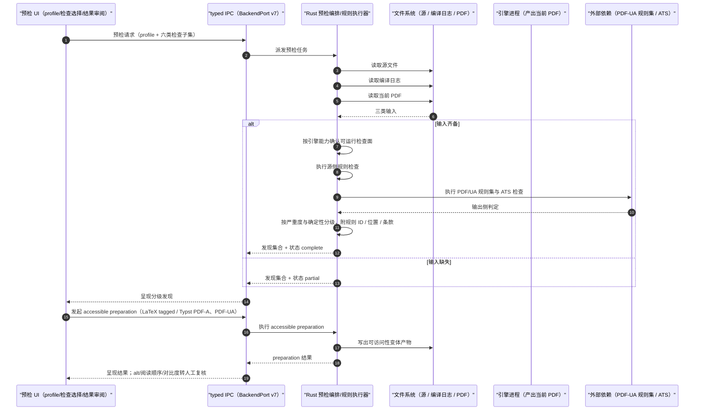

## S10 投稿前预检 场景实现（现状基线）

> **基线口径**：桌面 0.4.11，绑定提交 `9c307bf3c`（HEAD，领先 `v0.4.11` 标签 3 个提交）；本文件为**只读静态盘点**产物，未运行任何测试。
> **事实来源**：提案 `inventory.md` core 段 S10 行；`deltas/prd/1-product-requirements/core-01-requirements.md` S10 节；`deltas/prd/2-product-design/1-feature-specs/core-01-feature-specs.md` S10 节。
> **本文性质**：存量实现的场景时序基线。只记录已存在的调用链与边界，不新增交互、不发明实现细节。
> **调用面记号**：`【UI】` 前端界面 ／ `【typed IPC】` 前端↔Rust 结构化调用面 ／ `【Rust】` Rust 进程内模块 ／ `【引擎进程】` 编译引擎 ／ `【文件系统】` 本地磁盘 ／ `【外部依赖】` 进程外的第三方程序与规则资源。

### 一、触发与前置

- **触发条件**：投稿或提交前质量把关。
- **用户价值**：机器可查项先清零，减少返稿（痛点 P04 投稿规范核对繁琐）。
- **入口**：预检运行入口（选择投稿 profile 与六类检查）。
- **前置条件**：
  - 项目已存在且源文件已保存。
  - 六类检查：编译 / 规范 / 可访问性 / 引用 / 隐私 / ATS，可独立或一起运行。
  - 投稿 profile：arXiv / IEEE / ACM / 期刊 / 学位论文。
  - 预检读取**当前**编译日志与**当前** PDF；缺失输入走 F1（结果标 partial）。
- **本场景不覆盖**：编译执行（S07）、PDF 预览（S09）、导出（S11）、可访问性结论的人工/外部复核责任。

### 二、参与者

| 参与面 | 组件 | 职责 | 证据 |
|---|---|---|---|
| 前端 UI | 预检运行入口（profile 选择 + 六类检查勾选）、结果审阅视图（严重度、确定性、规则 ID、源/PDF 位置、标准条款）、可访问性导出准备入口 | 收集 profile 与检查项、发起运行、分级呈现发现、发起 accessible preparation | docs/Preflight.md L13-129；PrepExport.test.ts L14-69 |
| typed IPC | BackendPort v7（12 capabilities）调用面 | 前端向 Rust 侧提交预检请求，接收结构化发现集合与运行状态 | inventory.md「架构与测试要点·API 资产」；Tauri IPC 注册表 lib.rs L523-1251 |
| Rust 模块 | 预检编排模块、规则执行器、引擎能力判定模块、accessible preparation 模块 | 收集源/日志/PDF；按检查类别执行规则；按严重度与确定性分级；执行 LaTeX tagged preparation、Typst PDF/A 与 PDF/UA 导出 | docs/Preflight.md L13-129；engine-capabilities.test.ts L15-95；PrepExport.test.ts L14-69 |
| 引擎进程 | 产出当前 PDF 的编译引擎 | **不被预检重新拉起**：预检只**读取**其编译日志与 PDF；accessible preparation 阶段按需产出 tagged/PDF-A 变体 | docs/Preflight.md L13-129；inventory.md core 段 S10 行 |
| 文件系统 | 源文件、编译日志、当前 PDF | 预检的三类输入源；可访问性导出变体落盘于此 | docs/Preflight.md L13-129 |
| 外部依赖 | PDF/UA 机器规则集（106 条）、ATS 检查能力 | 提供输出侧可访问性规则的判定依据 | docs/Preflight.md L13-129；inventory.md core 段 S10 行 |

### 三、主时序

1. `【UI】` 选择投稿 profile（arXiv/IEEE/ACM/期刊/学位论文）与六类检查项（编译/规范/可访问性/引用/隐私/ATS），可独立或一起运行。
2. `【typed IPC】` 提交预检请求（profile + 选中的检查项）。
3. `【Rust】` 收集三类输入：源文件、编译日志、当前 PDF。
4. `【Rust】` 判定输入齐备性：缺失输入 → 结果标记 **partial**（见 F1）。
5. `【Rust】` 按引擎能力判定模块确认引擎支持的检查面（对应 engine-capabilities 契约）。
6. `【Rust】` 执行源侧规则检查：Markdown 项目**不做源规则检查**（见 F5），但 PDF/ATS 等输出检查仍可运行。
7. `【Rust】` 执行输出侧检查：PDF/UA 规则集、ATS。
8. `【Rust】` 按严重度与确定性分级，每条发现附**规则 ID**、**源位置或 PDF 位置**、**标准条款**。
9. `【typed IPC】` 返回发现集合与运行状态 → `【UI】` 分级呈现。
10. `【UI】` 用户逐条修复，或在兼容时发起 accessible preparation：LaTeX tagged preparation、Typst PDF/A 与 PDF/UA 导出。
11. `【UI】` 对 alt 文本质量、阅读顺序与对比度做人工/外部复核（不由机器检查代劳）。

### 四、失败与降级分支

| # | 触发 | 系统行为（实现现状） | 对应需求验收条件 |
|---|---|---|---|
| F1 | 所需输入缺失（如 source-only 模式且当前 PDF 缺失） | 结果标记 **partial**，**不得报告完全成功** | 异常：输入缺失 |
| F2 | 文档 class 与 accessible preparation 不兼容 | **拒绝** accessible preparation，并说明不兼容原因 | 异常：输入缺失（不兼容 class 拒绝 accessible preparation） |
| F3 | 源中出现未知 package | 只给 **caution**，不判为错误 | 异常：输入缺失（未知 package 只给 caution） |
| F4 | PDF/UA 机器规则共 106 条 | 该规则集是**子集**：未读取的证据不计通过，**不构成正式 conformance 声明** | 边界：能力声明 |
| F5 | 项目为 Markdown | 不做源规则检查；但 **PDF/ATS 等输出检查仍可运行** | 边界：能力声明 |
| F6 | 部分检查类别被单独勾选 | 未勾选的类别不运行；结果按实际运行的类别呈现，不补报未运行的检查为通过 | 主路径：六类检查独立或一起运行 |

**降级通则**：输入缺失只能降级为 partial，不得静默转为「通过」；机器可查结论不得升格为正式 conformance 声明。

### 五、边界与证据

**边界**

- 六类检查：编译 / 规范 / 可访问性 / 引用 / 隐私 / ATS；投稿 profile：arXiv / IEEE / ACM / 期刊 / 学位论文。
- 输入缺失 → partial，不报完全成功。
- 不兼容 document class 拒绝 accessible preparation；未知 package 只给 caution。
- 106 条 PDF/UA 机器规则是子集，未读取的证据不计通过，不构成正式 conformance 声明。
- Markdown 项目不做源规则检查，但 PDF/ATS 等输出检查仍可运行。
- alt 文本质量、阅读顺序、对比度需人工/外部复核。

**证据（inventory.md core 段 S10 行）**

- docs/Preflight.md L13-129
- engine-capabilities.test.ts L15-95
- PrepExport.test.ts L14-69
