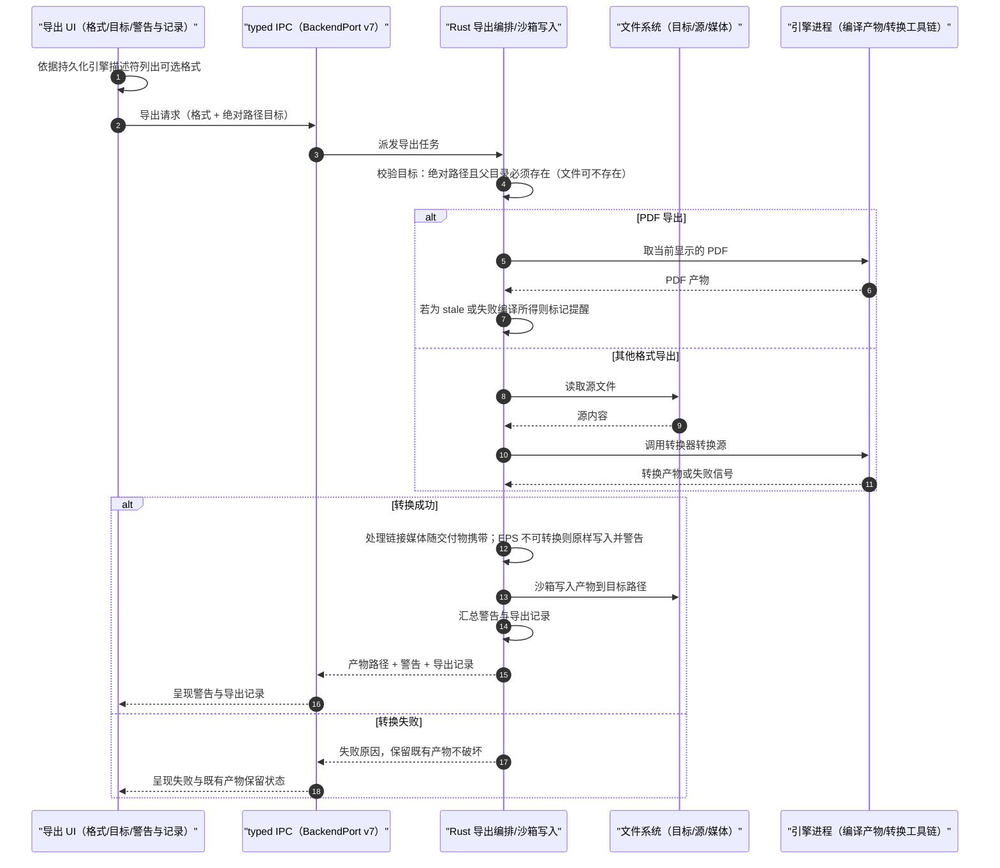

## S11 导出交付物 场景实现（现状基线）

> **基线口径**：桌面 0.4.11，绑定提交 `9c307bf3c`（HEAD，领先 `v0.4.11` 标签 3 个提交）；本文件为**只读静态盘点**产物，未运行任何测试。
> **事实来源**：提案 `inventory.md` core 段 S11 行（含偏差 D2）；`deltas/prd/1-product-requirements/core-01-requirements.md` S11 节；`deltas/prd/2-product-design/1-feature-specs/core-01-feature-specs.md` S11 节。
> **本文性质**：存量实现的场景时序基线。只记录已存在的调用链与边界，不新增交互、不发明实现细节。
> **调用面记号**：`【UI】` 前端界面 ／ `【typed IPC】` 前端↔Rust 结构化调用面 ／ `【Rust】` Rust 进程内模块 ／ `【引擎进程】` 编译/转换进程 ／ `【文件系统】` 本地磁盘 ／ `【外部依赖】` 进程外的第三方程序。

### 一、触发与前置

- **触发条件**：分享、投稿或归档。
- **用户价值**：一次操作产出目标格式并保留警告记录（痛点 P04 投稿规范核对繁琐）。
- **入口**：导出入口（可选格式由**持久化引擎描述符**声明）。
- **前置条件**：
  - 项目已存在；可选格式清单来自持久化的引擎描述符，不是硬编码全集。
  - 目标路径：必须是**绝对路径**，且**父目录必须存在**；目标文件**可以尚不存在**（实现语义，纠正文档 D2）。
  - PDF 路线导出的是**当前显示的 PDF**；其他路线导出转换后的源。
- **本场景不覆盖**：预检（S10）、检查点（S12）、转换器的通用工具入口（S14）。

### 二、参与者

| 参与面 | 组件 | 职责 | 证据 |
|---|---|---|---|
| 前端 UI | 导出入口（格式列表由引擎描述符声明）、目标路径选择器、警告与导出记录视图 | 选格式、选目标、发起导出、呈现警告与导出记录 | docs/Export.md L6-120；export.test.ts L332-499；e2e/55-export-artifacts.spec.ts L113-319 |
| typed IPC | BackendPort v7（12 capabilities）调用面 | 前端向 Rust 侧提交导出请求，接收产物路径与警告列表 | inventory.md「架构与测试要点·API 资产」；Tauri IPC 注册表 lib.rs L523-1251 |
| Rust 模块 | 导出编排模块、目标路径校验模块、沙箱写入模块、转换器调用层、导出记录模块 | 校验目标语义、调用转换器或保存当前 PDF、写入产物、汇总警告与导出记录 | sandbox.rs L97-118；export.test.ts L332-499 |
| 引擎进程 | 产出当前 PDF 的编译引擎；格式转换所用的本地工具链 | 提供被保存的当前 PDF；执行 DOCX/HTML/Markdown/TXT/PPTX/EPUB 等格式转换 | docs/Export.md L6-120；e2e/55-export-artifacts.spec.ts L113-319 |
| 文件系统 | 目标文件、源文件、媒体文件（图片等） | 产物落盘处；链接而非复制的媒体需随交付物携带 | sandbox.rs L97-118；docs/Export.md L6-120 |
| 外部依赖 | 本地转换工具链与 EPS 转换器 | 承担格式转换；EPS 不可转换时原样写入并警告 | docs/Export.md L6-120；inventory.md core 段 S11 行 |

### 三、主时序

1. `【UI】` 依据持久化引擎描述符列出可选目标格式（PDF / 源码 ZIP / DOCX / HTML / Markdown / TXT / Typst / LaTeX / PPTX / EPUB / Typst 图片等）。
2. `【UI】` 选择文件目标（绝对路径）。
3. `【typed IPC】` 提交导出请求（格式 + 目标路径）。
4. `【Rust】` 校验目标语义：绝对路径 + 父目录必须存在；**目标文件可不存在**（D2 实现语义）。
5. `【Rust】` 按格式分流：
   - PDF → 保存**当前显示的 PDF**（若该 PDF 为 stale 或来自失败编译 → 明确提醒，见 F3）；
   - 其他格式 → 由转换器转换源文件。
6. `【引擎进程】` 执行转换；`【Rust】` 沙箱写入产物到目标路径。
7. `【Rust】` 处理媒体与特殊格式：对**链接而非复制**的媒体，随交付物一并携带；EPS 不可转换 → 原样写入并警告（见 F4）。
8. `【Rust】` 汇总警告（缺失内容/图/引用/数学）与导出记录。
9. `【typed IPC】` 返回产物路径 + 警告 + 导出记录。
10. `【UI】` 呈现警告与导出记录。

### 四、失败与降级分支

| # | 触发 | 系统行为（实现现状） | 对应需求验收条件 |
|---|---|---|---|
| F1 | 目标格式转换失败 | **保留既有产物不破坏**（不覆盖已有交付物） | 异常：转换失败 |
| F2 | PowerPoint（PPTX）目标缺图 | **直接失败且不保存** | 异常：转换失败 |
| F3 | 导出的 PDF 是 stale 或来自失败编译 | **明确提醒**后仍按当前显示 PDF 处理 | 异常：转换失败 |
| F4 | 交付物含 EPS 且不可转换 | EPS **原样写入并警告** | 边界：EPS |
| F5 | 目标不是绝对路径，或父目录不存在 | 目标校验不通过，导出不执行 | 正常：标准导出（父目录必须存在——实现语义） |
| F6 | 交付物引用了链接而非复制的媒体 | 该媒体**随交付物携带**，不留下悬空链接 | 主路径：对链接而非复制的媒体随交付物携带 |

**降级通则**：转换失败优先「不破坏既有产物」；个别格式（PPTX）缺关键素材时宁可整体失败，也不产出半残缺交付物。

### 五、边界与证据

**边界**

- 可选格式由**持久化引擎描述符**声明。
- 导出目标语义（实现现状，纠正文档 D2）：**绝对路径 + 父目录必须存在；目标文件可以尚不存在**。
- 转换失败保留既有产物；PPTX 缺图直接失败且不保存。
- 导出 stale 或失败编译所得 PDF 时明确提醒。
- EPS 不可转换时原样写入并警告。
- 链接而非复制的媒体随交付物携带。

**证据（inventory.md core 段 S11 行）**

- docs/Export.md L6-120
- export.test.ts L332-499
- e2e/55-export-artifacts.spec.ts L113-319
- sandbox.rs L97-118（绝对路径 + 父目录存在，文件可不存在）
