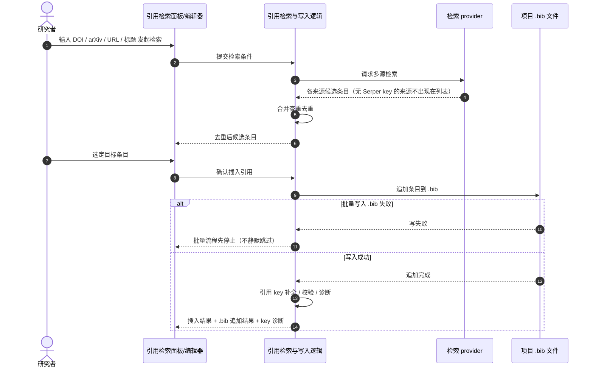

## S16 文献检索与引用写入 场景实现（现状基线）

> module: research | 场景编号: S16（全局唯一，见 `core-00-scenario-overview.md` 编号注册表） | 优先级: P0
> 基线口径：桌面 0.4.11，绑定提交 `9c307bf3c`（HEAD，领先 `v0.4.11` 标签 3 个提交）
> 本文档为存量产品现状基线：只描述已实现行为，事实来源为提案 `logos/changes/add-baseline-docs/inventory.md` research 段（S16 行）与 `deltas/prd/1-product-requirements/research-01-requirements.md` §四 S16 章节。**本次为只读静态盘点，未执行任何测试**，动态行为在 verify 阶段单独取证。
> 本文档不新增功能、不修复文档偏差（偏差 D4 等文档回补另立变更），基线一律以实现为准。

### 触发与前置

- **触发条件**：写作中需要引用文献并维护项目的 BibTeX 文件（需求文档 S16 触发条件）。
- **前置条件**：
  - 项目已存在，且项目本地引用文件（`.bib`）为引用写入的权威落点；
  - 检索来源（provider）可用时方可走多源检索；provider 不可用或未配置 Serper key 时走降级路径（见「失败与降级分支」）；
  - 网络可用时提供 DOI/arXiv/URL/标题四类检索入口；完全离线时检索环节不可用，但本地 `.bib` 写入路径仍然可用。

### 参与者

| 参与者 | 形态 | 职责 | 证据 |
|---|---|---|---|
| 研究者 | 用户 | 发起检索、审阅合并去重结果、触发引用插入与 `.bib` 追加 | `docs/Citations.md` L6-25 |
| 引用检索面板 / 编辑器 UI | 前端 | 承载检索输入、多源结果展示、合并去重、引用插入与 key 补全/校验/诊断的交互 | `docs/Citations.md` L98-135 |
| 引用检索与写入逻辑 | 前端/Rust（按 inventory 证据路径） | DOI/arXiv/URL/标题检索、多源结果合并查重、key 补全与校验、批量写入 `.bib` | `citation.test.ts` L480-605 |
| 检索 provider | 外部服务 | 提供 DOI/arXiv/URL/标题多源检索结果；Google Scholar 需 Serper key | `docs/Citations.md` L6-25 |
| 项目引用文件（`.bib`） | 文件系统 | 引用条目的权威落点；批量写入失败的停止点 | `docs/Citations.md` L6-25；`citation.test.ts` L480-605 |

### 主时序

1. **UI** — 研究者在编辑器中打开引用检索入口，按 DOI / arXiv / URL / 标题输入检索条件。
2. **typed IPC / 检索逻辑** — 向可用检索 provider 发起检索请求（多源场景并行）。
3. **检索 provider** — 返回各来源的候选条目列表；未配置 Serper key 的来源不返回该来源结果。
4. **检索逻辑** — 对多来源结果执行**合并查重**，产出去重后的候选集合。
5. **UI** — 展示去重后的候选条目与来源标识，由研究者选定目标条目。
6. **检索逻辑 / 文件系统** — 将选定条目插入文稿引用位置，并**追加**对应条目到项目 `.bib` 文件。
7. **检索逻辑** — 对引用 key 执行**补全、校验与诊断**：缺失 key 时提供补全，非法 key 给出校验结果与诊断信息。
8. **UI** — 呈现插入结果、`.bib` 追加结果与 key 诊断结论。

### 失败与降级分支

逐条对应需求文档 `research-01-requirements.md` §四 S16 验收条件中的「异常」与「边界」：

| 分支 | 触发条件 | 行为（基线口径） | 证据 |
|---|---|---|---|
| provider 不可用 | 某检索 provider 不可用 | 该 provider 不可用被**显式呈现**，不静默吞掉；其余可用来源的结果仍可展示 | `docs/Citations.md` L6-25；`citation.test.ts` L480-605 |
| 未配置 Serper key | 用户未配置 Serper key | 结果中**不列 Google Scholar**，不以空结果冒充"检索不到" | `docs/Citations.md` L6-25 |
| 完全离线 | 设备无网络 | 检索环节不可用；用户仍可**继续使用本地 `.bib` 完成引用写入**，引用工作不中断 | `docs/Citations.md` L6-25；需求文档 §5.1 |
| 批量写入 `.bib` 失败 | 批量流程中 `.bib` 写失败 | 批量流程**先停止**，不静默跳过继续执行 | `citation.test.ts` L480-605 |
| 引用 key 缺失或非法 | 条目缺 key 或 key 不合规 | 提供 key **补全、校验与诊断**，由用户处理，不自动写入非法 key | `docs/Citations.md` L98-135 |
| 参考文献文件导入（偏差 D4） | 用户导入 RIS/EndNote XML | 文档未列出该入口；E2E 经 devtools hook 可导入，记为「实现支持、UI 入口待确认」——基线**不表述为用户可见功能** | `inventory.md` 偏差 D4（`48-citation-import.spec.ts`） |

### 边界与证据

- **引用权威性边界**：项目本地 BibTeX/Hayagriva 引用文件是权威源；检索结果只是外部供给来源，不得取代本地 `.bib` 的权威性（需求文档 §5.1）。
- **网络边界**：多源检索为显式操作，失败必须显式呈现；离线降级路径为本地 `.bib`（需求文档 §5.1）。
- **外部写入保守性**：`.bib` 批量写失败即停；本场景不承担 Zotero 条目更新（属 S17，只追加、不自动删除、覆盖需确认）。
- **不做**：本场景不包含 Zotero 联合检索（S17）、草稿文献发现与 AI 评审（S18）、OCR 转换（S19）、研究规划与统计工具（S20）。
- **实现证据**：
  - `docs/Citations.md` L6-25（检索与引用写入主路径）、L98-135（key 补全/校验/诊断与相关交互）；
  - `citation.test.ts` L480-605（多源检索、合并去重、`.bib` 写入失败即停等行为）。
- **动态验证声明**：本基线为静态盘点，上述行为**未在本次执行任何测试**；`citation.test.ts` 的断言结果需在 verify 阶段取证，不得预填 PASS。
