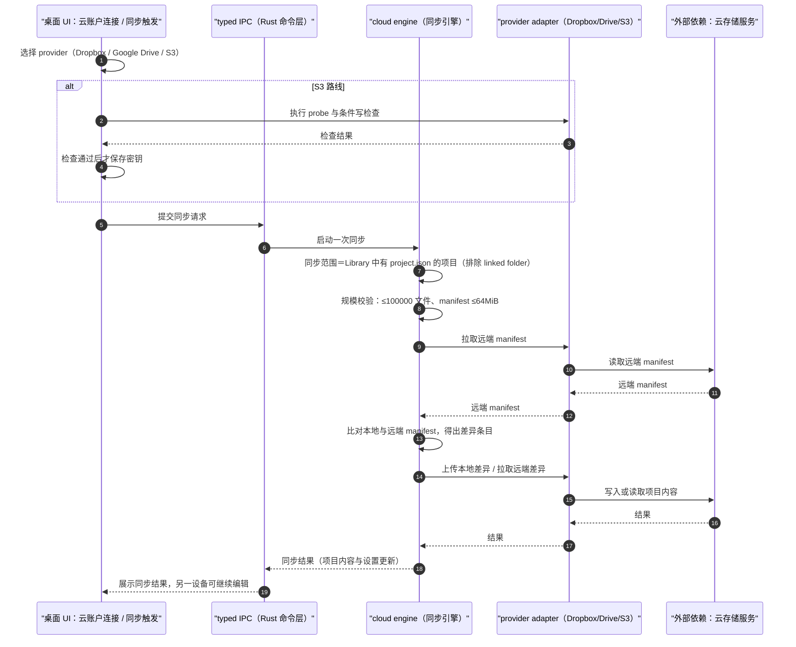

## S43 云同步多设备协作 场景实现（现状基线）

> **基线口径**：桌面 `0.4.11`，绑定提交 `9c307bf3c`（HEAD，领先 `v0.4.11` 标签 3 个提交）；本文件为**只读静态盘点**产物，未运行任何测试。
> **事实来源**：提案 `inventory.md` sync 段 S43 行；`deltas/prd/1-product-requirements/sync-01-requirements.md` S43 节；`deltas/prd/2-product-design/1-feature-specs/sync-01-feature-specs.md` S43 节。
> **本文性质**：存量实现的场景时序基线。只记录已存在的调用链与边界，不新增交互、不发明实现细节；实现与文档的偏差按**实现现状**记录。
> **口径声明（不可混称）**：**云同步 ≠ 实时协作**。云同步是设备间、文件级的最终一致同步，基于云存储上的 **manifest 比对**；实时协作（collab 模块 S29-S42）是基于 Loro CRDT change log 的多端并发实时收敛。两套机制正交、独立运行、互不替代：不得把云同步宣传为实时协作，也不得把 CRDT 自动合并能力宣传到云同步路径上。
> **调用面记号**：`【UI】` 前端界面 ／ `【typed IPC】` 前端↔Rust 结构化调用面 ／ `【Rust】` Rust 进程内模块 ／ `【文件系统】` 本地磁盘 ／ `【外部依赖】` 进程外的云存储服务。

### 一、触发与前置

- **触发条件**：用户需要在多台设备（台式机、笔记本、实验室机器）之间继续同一个项目工作。
- **用户价值**：用自己的云存储获得多设备一致的 Library 项目与设置，无需人工拷贝（痛点 P01 多设备工作上下文割裂）。
- **入口**：云存储账户连接入口（Dropbox / Google Drive / S3 三类 provider）与同步触发。
- **前置条件**：
  - 应用已启动且项目库可用；用户已连接（在本设备完成配置）云存储账户。
  - S3 路线：**先执行 probe 与条件写检查，检查通过后才保存密钥**。
  - 被同步项目必须是 **Library 中有 `project.json` 的项目**。
- **本场景不覆盖**：冲突副本与三方合并（S44）、批量删除保护与回收站（S45）、云账户切换与断开（S46）、实时协作（S29-S42）。

### 二、参与者

| 参与面 | 组件 | 职责 | 证据 |
|---|---|---|---|
| 桌面 UI | 云存储账户连接界面（Dropbox / Google Drive / S3）、同步触发与状态展示 | 收集 provider 与凭据输入；S3 路线触发 probe + 条件写检查后提交保存；展示同步结果 | cloud/provider.rs L12-75；commands.rs L749-800 |
| typed IPC | Rust 命令层（云同步相关 command） | 承接连接、配置与同步请求，调度 cloud engine 并回传结构化结果 | commands.rs L1646-2142 |
| cloud engine | 云同步引擎（engine.rs） | 计算同步范围与规模上限、生成并**比对本地与远端 manifest**、驱动差异的拉取与上传 | engine.rs L21-47；engine.rs L3486-3845；commands.rs L1646-2142 |
| provider adapter | 云存储适配层（cloud/provider.rs）：Dropbox / Google Drive / S3 | 抽象三家 provider 的读写接口；承载 S3 的 probe 与条件写检查 | cloud/provider.rs L12-75；commands.rs L749-800 |
| 文件系统 | 本地 Library 目录与云存储空间 | 提供待同步项目内容与 manifest 落点 | engine.rs L21-47；engine.rs L3486-3845 |
| 外部依赖 | 云存储服务（Dropbox / Google Drive / S3） | 保存远端项目内容与 manifest，是跨设备一致性的唯一载体 | cloud/provider.rs L12-75 |
| （不涉及）实时协作通道 | Loro CRDT change log / Server（collab 模块） | **本场景完全不涉及**：与云同步正交，不共享通道、不提供自动文本合并 | inventory.md collab 段 S29-S42；sync-01-requirements.md §1.1 |

### 三、主时序

1. `【UI】` 用户在设置中连接云存储账户，选择 Dropbox / Google Drive / S3 之一。
2. `【UI】` / `【Rust】` 若为 S3 路线，**先执行 probe 与条件写检查**；检查通过后才保存密钥，未通过则不落盘密钥。
3. `【typed IPC】` 前端提交同步请求。
4. `【Rust】` cloud engine 计算**同步范围**：只取 Library 中**有 `project.json`** 的项目；任意 linked folder **不在范围内**。
5. `【Rust】` cloud engine 校验**规模上限**：单项目文件数 ≤ 100000、manifest ≤ 64MiB。
6. `【Rust】` cloud engine 生成本地 manifest，并通过 provider adapter 拉取远端 manifest。
7. `【Rust】` cloud engine **比对两侧 manifest**，得出需上传与需拉取的差异条目。
8. `【Rust】` 通过 provider adapter 上传本地差异（设备 A 侧写入云存储）。
9. `【外部依赖】` 云存储保存远端项目内容与 manifest。
10. 在设备 B 连接同一云存储账户并触发同步：`【Rust】` cloud engine 同样生成并**比对 manifest**，识别出设备 A 写入的差异。
11. `【Rust】` 通过 provider adapter 拉取差异并落到设备 B 的本地 Library；设置类内容同步更新。
12. `【UI】` 设备 B 展示同步结果，用户在该项目上继续编辑。

### 四、失败与降级分支

| # | 触发 | 系统行为（实现现状） | 对应需求验收条件 |
|---|---|---|---|
| F1 | S3 的 probe 或条件写检查未通过 | **不保存密钥**，同步不启动 | 正常：S3 密钥保存前检查 |
| F2 | 单项目文件数超过 100000，或 manifest 超过 64MiB | 超出规模上限，该项目不参与本次同步（规模受限） | 异常：同步范围与上限 |
| F3 | 目标不在 Library 范围内，或项目缺少 `project.json` | 该对象**不被同步**（只同步 Library 中有 `project.json` 的项目） | 异常：同步范围与上限 |
| F4 | 目标为 Library 之外的任意 linked folder | **不被同步** | 异常：同步范围与上限 |
| F5 | 项目内 `.git` 历史与 checkpoints | **不随云同步**；检查点与本地 Git（S12/S13）与云同步完全独立、互不替代 | 异常：同步范围与上限 |
| F6 | 云存储侧 provider 访问失败 | 同步以显式错误结束，不做静默丢弃或静默删除 | inventory.md S43 行（同步失败不静默） |

**降级通则**：本场景的失败一律以**显式错误**结束；被排除在同步范围外的对象不被静默改写。

### 五、边界与证据

**边界**

- **云同步与实时协作是两套正交机制**：本场景只做设备间文件级最终一致（manifest 比对），不做 CRDT 自动合并、不做多人实时协作。
- 同步范围：只同步 **Library 中有 `project.json` 的项目**，不含任意 linked folder。
- 不同步内容：`.git` 历史与 checkpoints。
- 规模上限：单项目 100000 文件、manifest 64MiB。
- S3 密钥保存前先 probe + 条件写检查。
- 现状声明：真实云服务商账户（Dropbox / Drive / S3）下的动态行为**未在本次执行测试**，verify 阶段单独取证。

**证据（inventory.md sync 段 S43 行）**

- cloud/provider.rs L12-75
- commands.rs L749-800（probe + 条件写检查）、L1646-2142（同步命令）
- engine.rs L21-47（同步范围）、L3486-3845（同步执行与 manifest 比对）
