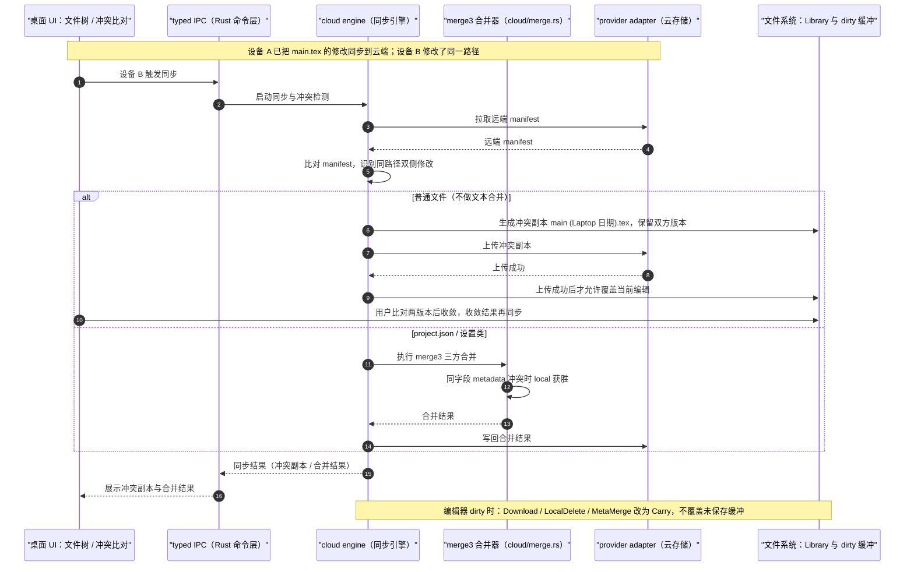

## S44 冲突副本与三方合并 场景实现（现状基线）

> **基线口径**：桌面 `0.4.11`，绑定提交 `9c307bf3c`（HEAD，领先 `v0.4.11` 标签 3 个提交）；本文件为**只读静态盘点**产物，未运行任何测试。
> **事实来源**：提案 `inventory.md` sync 段 S44 行；`deltas/prd/1-product-requirements/sync-01-requirements.md` S44 节；`deltas/prd/2-product-design/1-feature-specs/sync-01-feature-specs.md` S44 节。
> **本文性质**：存量实现的场景时序基线。只记录已存在的调用链与边界，不新增交互、不发明实现细节；实现与文档的偏差按**实现现状**记录。
> **口径声明（不可混称）**：**云同步 ≠ 实时协作**。云同步路径上**普通文件双侧修改不做文本合并**，而是保留冲突副本（两版本都留）；`project.json` 与设置类走 **merge3 三方合并**。这与 collab 模块的 Loro CRDT 自动合并是**两套正交机制**，不得把 CRDT 自动合并能力宣传到云同步路径上。
> **调用面记号**：`【UI】` 前端界面 ／ `【typed IPC】` 前端↔Rust 结构化调用面 ／ `【Rust】` Rust 进程内模块 ／ `【文件系统】` 本地磁盘 ／ `【外部依赖】` 进程外的云存储服务。

### 一、触发与前置

- **触发条件**：两台设备先后修改了同一个文件（普通文件或 `project.json` / 设置类）后触发同步。
- **用户价值**：双侧修改都不丢，冲突可见、可收敛（痛点 P01 多设备工作上下文割裂）。
- **入口**：云同步过程中的 manifest 比对结果处理（冲突检测）；冲突副本在文件树中的呈现。
- **前置条件**：
  - 双侧设备已连接同一云存储账户，且此前至少完成过一次成功同步（否则无共同祖先可比对）。
  - 冲突检测依赖 manifest 比对结果（见 S43 主时序第 7 步）。
- **本场景不覆盖**：云同步的连接与范围判定（S43）、批量删除 hold 与 Trash（S45）、实时协作的 Loro 自动合并与 Merge Review（S29-S42）。

### 二、参与者

| 参与面 | 组件 | 职责 | 证据 |
|---|---|---|---|
| 桌面 UI | 文件树（冲突副本 `main (Laptop 日期).tex` 的呈现与比对）、同步状态与错误展示 | 呈现两个版本供用户比对收敛；呈现 merge3 合并结果与本地获胜的字段 | engine.rs L1110-1186；tests/engine.rs L275-306 |
| typed IPC | Rust 命令层（同步与冲突处理调用面） | 调度冲突检测、冲突副本写入与 merge3 合并，回传结构化结果 | commands.rs L1646-2142 |
| cloud engine | 云同步引擎（engine.rs） | 在 manifest 比对中识别双侧修改；按文件类型分流到冲突副本或 merge3；协调 Carry 处理 | engine.rs L1110-1186；tests/engine.rs L521-582、L1850-1891 |
| merge3 合并器 | 三方合并模块（cloud/merge.rs） | 处理 `project.json` 与设置类的三方合并；同字段 metadata 冲突时 **local 获胜** | cloud/merge.rs L4-207 |
| provider adapter | 云存储适配层（cloud/provider.rs） | 在冲突副本与合并结果落盘后回写云存储；上传未成功前不覆盖当前编辑 | cloud/provider.rs L12-75 |
| 文件系统 | 本地 Library 目录、编辑器未保存（dirty）缓冲 | 承载冲突副本文件与当前编辑缓冲；冲突副本上传成功前不覆盖当前编辑 | tests/engine.rs L521-582、L1850-1891 |
| 外部依赖 | 云存储服务 | 保存双侧版本，是冲突副本与合并结果的远端落点 | cloud/provider.rs L12-75 |
| （不涉及）实时协作通道 | Loro CRDT change log / Merge Review（collab 模块） | **本场景完全不涉及**：冲突副本不是 CRDT 自动合并的产物 | inventory.md collab 段 S29-S42 |

### 三、主时序

1. 设备 A 修改普通文件 `main.tex` 并完成同步：manifest 更新，版本写入云存储。
2. 设备 B 修改**同一路径**的 `main.tex`（此时尚未同步）。
3. 设备 B 触发同步：`【Rust】` cloud engine 生成并**比对两侧 manifest**，识别出同一路径被双侧修改。
4. `【Rust】` cloud engine 按文件类型分流：
   - **普通文件**：**不做文本合并**，改为生成冲突副本 `main (Laptop 日期).tex`（命名含设备与日期）；
   - **`project.json` / 设置类**：进入 **merge3 三方合并**。
5. `【Rust】` **后到者保留双方**：先到的版本不被覆盖，两个版本都保留。
6. `【Rust】` 冲突副本写入本地后经 provider adapter 上传；**冲突副本上传成功前不覆盖当前编辑**。
7. `【UI】` 用户在文件树看到两个版本，比对后收敛（删除多余副本或保留其一），收敛结果再同步，双方趋于一致。
8. merge3 分支：`【Rust】` merge3 合并器产出合并后的 `project.json` / 设置；**同字段 metadata 冲突时 local 获胜**。
9. dirty 保护：`【Rust】` 若编辑器存在未保存（dirty）缓冲，**Download / LocalDelete / MetaMerge 类同步操作改为 Carry 处理**，不覆盖未保存缓冲。

### 四、失败与降级分支

| # | 触发 | 系统行为（实现现状） | 对应需求验收条件 |
|---|---|---|---|
| F1 | 普通文件双侧修改 | **保留两个版本（冲突副本）**，不自动合并正文；先到版本不被覆盖 | 正常：普通文件冲突副本 |
| F2 | `project.json` / 设置双侧修改 | 走 **merge3 三方合并**而非冲突副本；同字段 metadata 冲突时 **local 获胜** | 正常：元数据三方合并 |
| F3 | 编辑器存在 dirty（未保存）缓冲，且同步带来 Download / LocalDelete / MetaMerge | 改为 **Carry** 处理，**不覆盖未保存缓冲** | 异常：未保存缓冲保护 |
| F4 | 冲突副本尚未上传成功 | **当前编辑不被冲突副本处理覆盖** | 异常：冲突副本上传前保护 |
| F5 | 用户尚未对两个版本做出收敛选择 | 两个版本并存于 Library，等待用户比对后收敛；同步不做自动取舍 | inventory.md S44 行「后到者保留双方 → 收敛」 |

**降级通则**：本场景**不以「后到覆盖先到」作为降级**；冲突一律以「双版本并存 + 用户收敛」结束。

### 五、边界与证据

**边界**

- **云同步与实时协作是两套正交机制**：本场景的冲突副本机制属云同步路径，与 collab 的 Loro CRDT 自动合并、只读 Merge Review 无关且不可互相宣传。
- 普通文件双侧修改**不做文本合并**，保留双版本由用户收敛。
- `project.json` / 设置走 merge3；同字段 metadata 冲突 local 获胜。
- dirty 缓冲下 Download / LocalDelete / MetaMerge 改 Carry，不覆盖未保存缓冲。
- 冲突副本上传成功前不覆盖当前编辑。
- 现状声明：本文件为静态盘点，未执行任何测试；真实双设备环境下的冲突文件名日期格式等动态细节在 verify 阶段单独取证。

**证据（inventory.md sync 段 S44 行）**

- engine.rs L1110-1186（冲突副本生成与分流）
- tests/engine.rs L275-306（冲突副本命名）、L521-582（dirty → Carry）、L1850-1891（上传成功前不覆盖当前编辑）
- cloud/merge.rs L4-207（merge3 三方合并，metadata 冲突 local 获胜）
