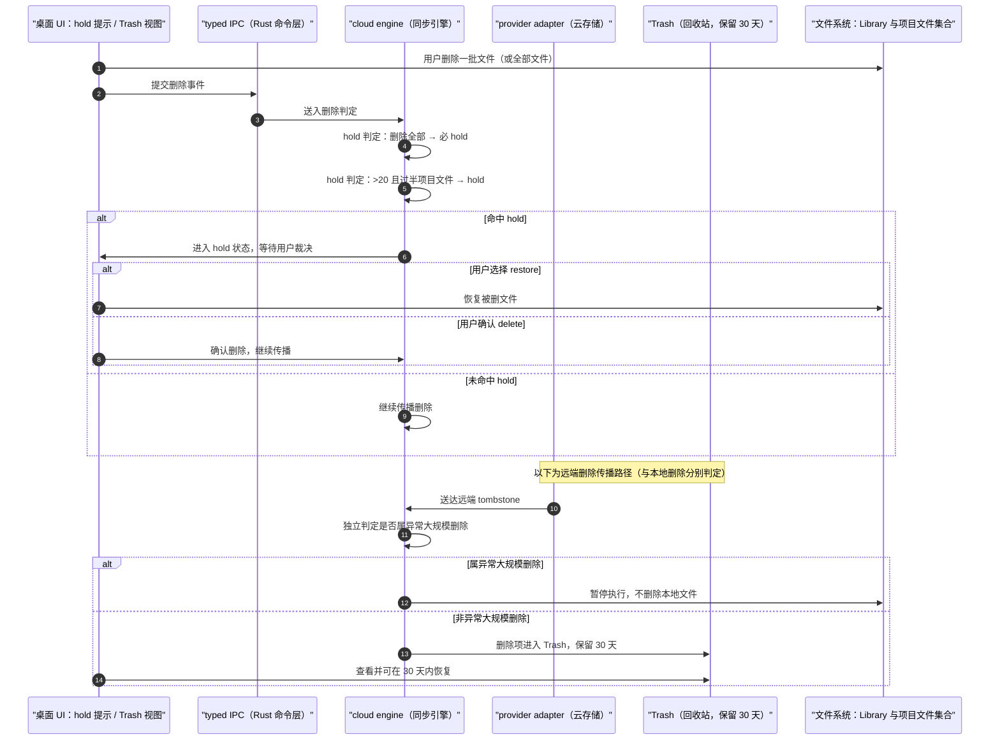

## S45 批量删除保护与回收站 场景实现（现状基线）

> **基线口径**：桌面 `0.4.11`，绑定提交 `9c307bf3c`（HEAD，领先 `v0.4.11` 标签 3 个提交）；本文件为**只读静态盘点**产物，未运行任何测试。
> **事实来源**：提案 `inventory.md` sync 段 S45 行；`deltas/prd/1-product-requirements/sync-01-requirements.md` S45 节；`deltas/prd/2-product-design/1-feature-specs/sync-01-feature-specs.md` S45 节。
> **本文性质**：存量实现的场景时序基线。只记录已存在的调用链与边界，不新增交互、不发明实现细节；实现与文档的偏差按**实现现状**记录。
> **口径声明（不可混称）**：**云同步 ≠ 实时协作**。本场景的删除保护（hold）与回收站（Trash）属**云同步路径**的最终一致语义，与 collab 模块（S29-S42）的实时协作同步是两套正交机制：协作侧的「大批量外部磁盘变化进暂停（Send / Keep local）」不是本场景的 hold/Trash 语义，两者不可混称。
> **调用面记号**：`【UI】` 前端界面 ／ `【typed IPC】` 前端↔Rust 结构化调用面 ／ `【Rust】` Rust 进程内模块 ／ `【文件系统】` 本地磁盘 ／ `【外部依赖】` 进程外的云存储服务。

### 一、触发与前置

- **触发条件**：一次删除大量文件（或删除全部文件），或另一设备的删除经同步传播到本机。
- **用户价值**：误删有兜底，删除可恢复（痛点 P02 跨设备误删放大）。
- **入口**：同步引擎对删除集合的判定环节；hold 状态下的用户选择（restore / 确认 delete）；Trash 中的恢复操作。
- **前置条件**：
  - 设备已连接云存储账户并参与同步；删除事件经 manifest 比对被识别。
  - **本地删除与远端删除分别判定**：本地删除按本机删除集合判定，**远端 tombstone 传播的删除按本机侧判定**。
- **本场景不覆盖**：冲突副本与 merge3（S44）、云账户切换与断开（S46）、实时协作侧的 Send / Keep local 暂停（S32）。

### 二、参与者

| 参与面 | 组件 | 职责 | 证据 |
|---|---|---|---|
| 桌面 UI | 同步状态与 hold 提示、Trash 视图、restore / 确认 delete 操作 | 展示 hold 原因；让用户选择 restore 或确认删除；展示 Trash 内条目并支持恢复 | engine.rs L1237-1279；tests/engine.rs L321-418 |
| typed IPC | Rust 命令层（同步与删除处理调用面） | 调度删除判定、hold 交互与 Trash 写入/恢复，回传结构化结果 | commands.rs L1646-2142 |
| cloud engine | 云同步引擎（engine.rs） | **hold 判定**（删除全部必 hold；删除 > 20 且过半项目文件则 hold）；本地与远端**分别判定**；远端删除转 Trash | engine.rs L1237-1279；tests/engine.rs L1761-1799、L2072-2134 |
| provider adapter | 云存储适配层（cloud/provider.rs） | 读取远端 tombstone、回写删除与恢复结果 | cloud/provider.rs L12-75 |
| Trash | 回收站（远端传播删除的落点） | 承接由同步传播的删除，**保留 30 天**，期内可恢复 | inventory.md S45 行「远端删除进 Trash；Trash 30 天」；tests/engine.rs L321-418 |
| 文件系统 | 本地 Library 目录、项目文件集合 | 提供被删文件本体与项目文件总数（过半判定分母） | engine.rs L1237-1279；tests/engine.rs L321-418 |
| 外部依赖 | 云存储服务 | 传播删除 tombstone，容纳 Trash 内容 | cloud/provider.rs L12-75 |
| （不涉及）实时协作通道 | collab 同步暂停（Send / Keep local） | **本场景完全不涉及**：与 hold / Trash 属不同机制 | inventory.md collab 段 S32 |

### 三、主时序

1. `【UI】` 用户在本地删除一批文件（或删除全部文件）。
2. `【Rust】` cloud engine 对删除集合执行 **hold 判定**：
   - **删除全部项目文件 → 必 hold**；
   - **删除数量 > 20 且超过项目文件数的一半 → hold**；
   - 其余情形不 hold。
3. `【Rust】` 进入 **hold 状态**，同步在此**暂停等待用户裁决**，不继续传播删除。
4. `【UI】` 用户选择 **restore（恢复）** 或 **确认 delete（删除）**；裁决结果驱动后续动作。
5. 远端删除路径：`【provider adapter】` 读取远端 tombstone → `【Rust】` cloud engine 处理该删除；**本地与远端分别判定**。
6. `【Trash】` 由远端传播而来的删除**进入 Trash**（而非直接消失），**保留 30 天**，期内可恢复。
7. 远端 tombstone 传播的删除在本机被判定为**异常大规模删除**时：`【Rust】` **暂停执行，不删除本地文件**。
8. `【UI】` 用户可在 Trash 中查看并恢复条目；超过 30 天后回收站不再保证保留。

### 四、失败与降级分支

| # | 触发 | 系统行为（实现现状） | 对应需求验收条件 |
|---|---|---|---|
| F1 | 删除**全部**项目文件 | **必进入 hold**，同步暂停等待用户裁决 | 异常：本地批量删除 hold |
| F2 | 删除数量 **> 20 且过半**项目文件 | **进入 hold**，同步暂停等待用户裁决 | 异常：本地批量删除 hold |
| F3 | 删除未命中 hold 条件 | 正常传播删除，不额外拦截 | inventory.md S45 行 |
| F4 | 远端 tombstone 传播的删除在本机判定为**异常大规模删除** | **暂停执行，不删除本地文件** | 异常：tombstone 异地暂停 |
| F5 | 远端传播的删除被接受 | 进入 **Trash** 而非直接消失，**保留 30 天**，期内可恢复 | 正常：远端删除进回收站 |
| F6 | hold 状态下用户未裁决 | 同步保持暂停等待，不自动恢复也不自动确认删除 | inventory.md S45 行「hold → restore 或确认 delete」 |
| F7 | Trash 条目超过 30 天 | 不再保证保留（Trash 保留期为 30 天） | inventory.md S45 行「Trash 30 天」 |

**降级通则**：删除类失败一律不静默生效——要么 hold 等用户裁决，要么进 Trash 保留 30 天，要么暂停不删本地文件；不存在「直接消失且不可恢复」的路径。

### 五、边界与证据

**边界**

- **hold 判定口径**：删除全部 → 必 hold；删除 > 20 且**过半**项目文件 → hold。
- **本地与远端分别判定**：本地删除集合与远端 tombstone 传播的删除各自独立判定，互不借用结论。
- 远端 tombstone 在本机判定为异常大规模删除时：**暂停执行，不删除本地文件**。
- 远端删除进 **Trash**，保留 **30 天**，期内可恢复。
- 云同步与实时协作正交：collab 侧的 Send / Keep local 暂停不是本场景的 hold / Trash 语义。
- 现状声明：本文件为静态盘点，未执行任何测试；真实多设备环境下的删除判定动态表现于 verify 阶段单独取证。

**证据（inventory.md sync 段 S45 行）**

- engine.rs L1237-1279（hold 判定与删除处理）
- tests/engine.rs L321-418（hold 判定与 Trash）、L1761-1799、L2072-2134（tombstone 异地暂停，不删本地）
